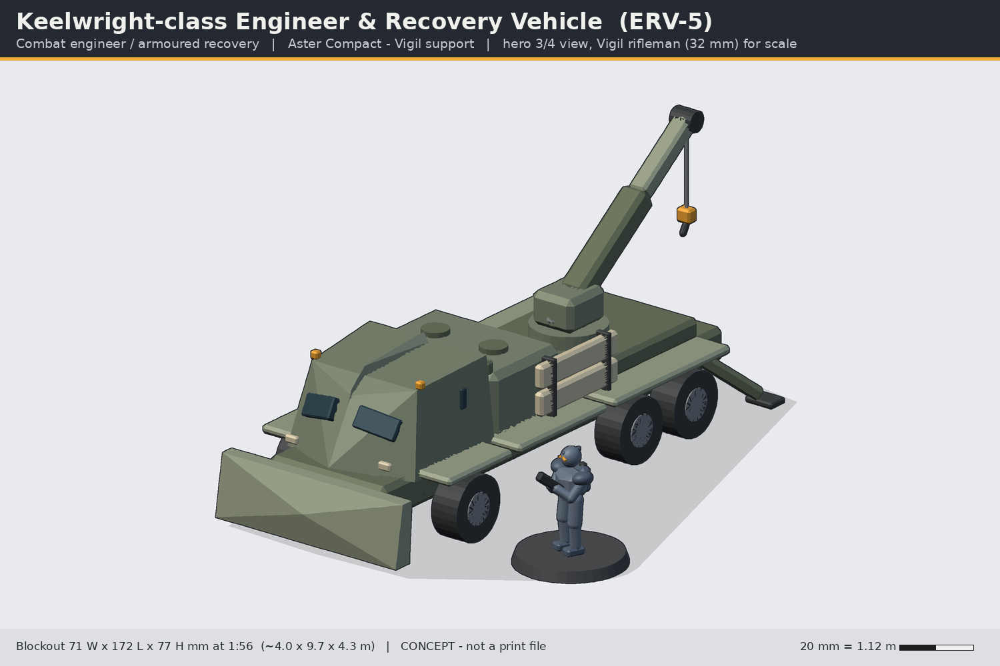
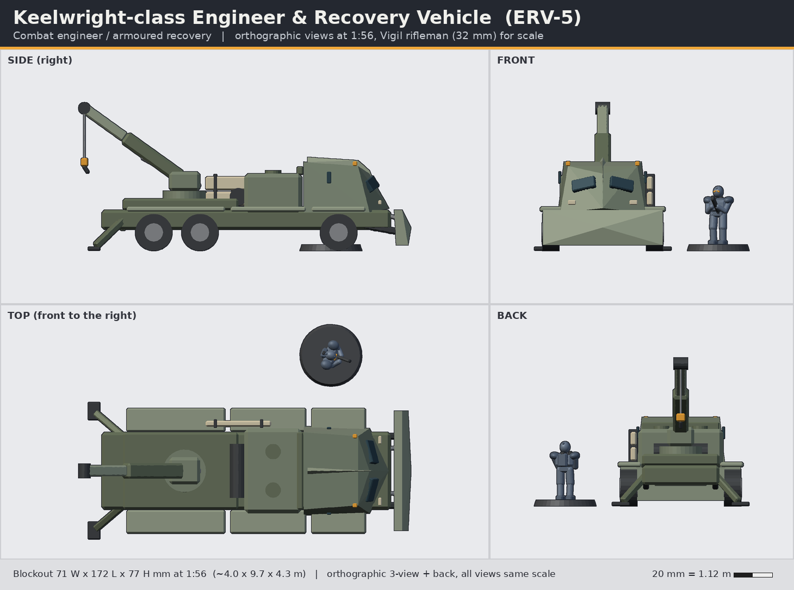

# Keelwright-class Engineer & Recovery Vehicle (ERV-5)

> Status: **concept** (code-built blockout, not a print-ready sculpt). Lane: armour, walkers & drones. Aster Compact / Vigil support.

**Pitch:** A 6x6 workhorse with a dozer blade, a crane and a sapper team: it clears the road and drags the Rampart home.

| | |
|---|---|
| Id | `armour-keelwright-erv` |
| Designation | ERV-5 |
| Role | Combat engineer / armoured recovery |
| Drive | wheeled 6x6 |
| Crew | 2 + 4 (driver, crane operator; 4-trooper Vigil sapper team in the rear bay) |
| Capacity | 4 sappers + bridging planks; crane ~12 t, winch 30 t |
| Base | none; hull sits on its wheels |

## Battlefield role
The Keelwright keeps the Vigil moving: it bulldozes rubble and obstacles, lays bridging planks across ditches, carries a four-trooper Vigil sapper team with charges and tools, and recovers knocked-out Ramparts or Talus frames with its slewing crane, winch and rear spades. On the table it is an objective-enabler: clears terrain, repairs, recovers.

## Silhouette and drive
Wheeled 6x6 (one axle under the cab, a bogie pair at the rear). Cab-forward with an armoured chevron-nosed cab, a full-width dozer blade, a boxy sapper bay, and a tall telescopic crane rising at the rear: an asymmetric, high, working-vehicle silhouette distinct from the low Rampart.

## Dimensions
| | In world | 1:56 print |
|---|---|---|
| Length (blade to spades) | 9.7 m | 172 mm |
| Width (fenders / blade) | 4.0 m | 71 mm |
| Height crane raised | 4.3 m | 77 mm |
| Height cab roof (crane stowed) | 2.7 m | 48 mm |
| Wheels | 1.06 m dia | 19 mm dia |
No base; optional belly magnets.

## Design language (ties to the Vigil)
- **Split chevron windscreen**: two angled screens either side of a central **keel pillar** - the visor layout of the Vigil helm - and the keel continues as a crest along the cab roof.
- **Chevron nose**: the cab is a V in plan, like the Rampart turret.
- **Plate rhythm**: fenders long-short-long; bone-coloured bridging planks and lamps; amber beacons and hook block.

## Modularity and kit-bash
- Crane turntable uses the **same 40 mm ring drum as the Rampart turret** - recovery crane, Breach mortar and bridge layer are interchangeable top modules (and a Rampart turret could sit on it for a "field conversion" kit-bash).
- Sapper bay roof hatches take **VH helmed** half-figures on the standard 1.6 mm peg.
- Wheels shared x6 (one master); blade and spades shared with a future bulldozer/APC variant.

## Printing notes (MSLA resin, rough split)
1. Chassis tub + fenders (hollow).
2. Cab (hollow, separate clear-resin or painted windscreens).
3. Sapper bay + recovery deck.
4. Crane: turntable, outer boom, telescopic boom (solid 5 mm), hook block; cable = 0.5 mm wire or thread (not printed).
5. Wheels x 6, blade + arms, spade legs x 2, bridging planks.
Estimated resin: ~45-60 ml hollowed.

## Open questions for the owner
1. Crane pose: fixed working pose (current) or stowed-flat option for transport?
2. 6x6 wheeled (current) or half-track to share track parts with the Rampart?
3. Do you want the sapper team modelled as separate figures (dismount kit) as part of this kit?

## Loadout options
- **A (Recovery)**: slewing telescopic crane + 30 t winch, rear spades; roof pintle (Talon carbine).
- **B (Sapper)**: crane replaced by a Breach mortar (demolition charge projector); dozer blade, mine-plough.
- **C (Bridger)**: crane replaced by a folding scissor bridge (12 m); dozer blade.

## Files
- `source/concept.py` - blockout generator (primitives + convex hulls, 1:56 mm, z up, faces -y) using `concepts/_tools/armour_kit.py`; writes `images/` and `blockout/armour-keelwright-erv-blockout.stl`.
- `blockout/armour-keelwright-erv-blockout.stl` - merged blockout mesh for proportion checks only (not printable as-is).
- Rebuild: `~/ai-stack/venvs/sculpt/bin/python concepts/armour-keelwright-erv/source/concept.py`

All shapes are original to this line; nothing is copied from Warhammer/40k, Halo, BattleTech or any other IP.
