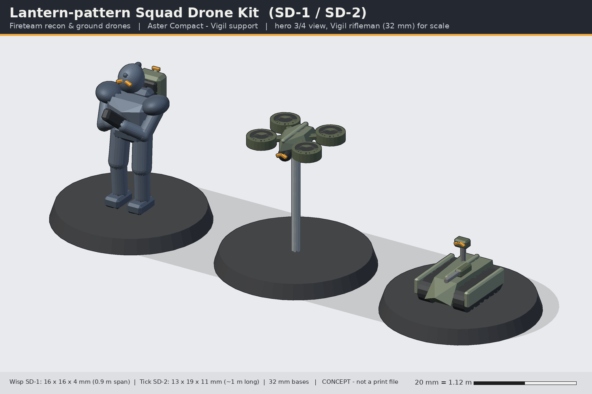
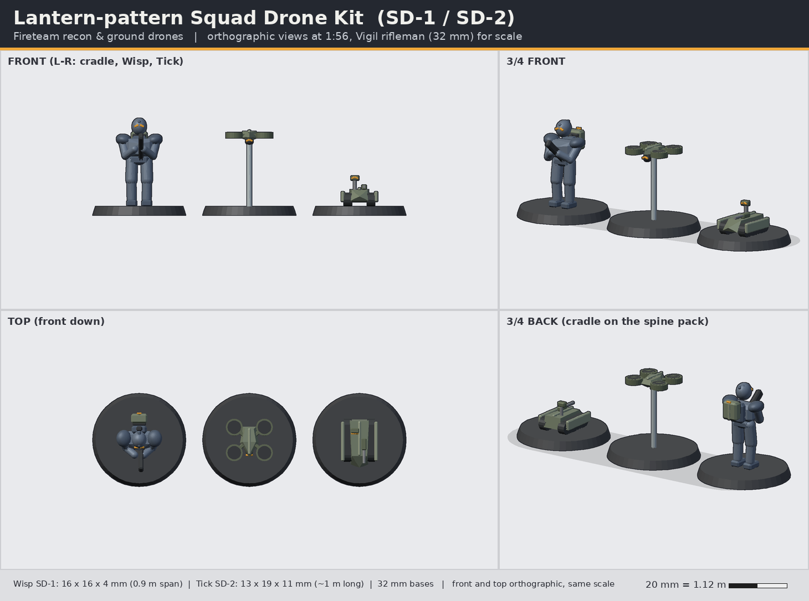

# Lantern-pattern Squad Drone Kit (SD-1 Wisp / SD-2 Tick / SD-C cradle)

> Status: **concept** (code-built blockout, not a print-ready sculpt). Lane: armour, walkers & drones. Aster Compact / Vigil support.

**Pitch:** Two tiny squad drones and a backpack cradle: the fireteam's eyes in the air and nose on the ground.

| | |
|---|---|
| Id | `armour-lantern-drones` |
| Designation | SD-1 Wisp / SD-2 Tick / SD-C cradle |
| Role | Fireteam recon & ground drones |
| Drive | rotor (SD-1 quadcopter) + tracked (SD-2 ground drone) |
| Crew | 0 (controlled by a Vigil fireteam member) |
| Capacity | SD-2 can carry one 0.4 m payload pod (charges, med pack, relay) |
| Base | 32 mm round (same as infantry, 5x2 mm magnet); Wisp on a 1.6 mm clear stem |

## Battlefield role
Every Vigil fireteam carries a Lantern kit. The **Wisp** quadcopter scouts ahead, spots for the Rampart's gun or the Pathbearer's mortar, and folds onto the **SD-C cradle** on a trooper's spine power pack. The **Tick** ground drone crawls ahead through rubble: it carries a carbine, clears or lays charges, or drops a comms relay. Both are small enough to sit on 32 mm infantry bases and act as squad tokens.

## Silhouette and drive
Wisp: rotor (four ducted fans) on a chevron-plan body. Tick: miniature tracked crawler with a chevron prow and a periscope sensor mast. Neither resembles the big vehicles; the kit adds a new scale tier to the line.

## Dimensions
| | In world | 1:56 print |
|---|---|---|
| Wisp span (ducts) | 0.9 m | 16 mm |
| Wisp height | 0.22 m | 4 mm (on a ~22 mm stem) |
| Tick L x W x H (mast) | 1.05 x 0.7 x 0.6 m | 19 x 13 x 11 mm |
| SD-C cradle + folded Wisp | 0.33 x 0.2 x 0.36 m | 6 x 4 x 6.5 mm |
Bases: 32 mm round x 3 mm with the standard 5x2 mm magnet; Wisp on a 1.6 mm clear acrylic/resin stem (separate).

## Design language (ties to the Vigil)
- Both drones carry the **split chevron** as their sensor lenses (Wisp chin ball, Tick mast head) and a **keel** spine/ridge along the top.
- The Wisp's body is a chevron in plan; the Tick's prow is a chevron in plan.
- The SD-C cradle plugs into the spine power pack's back plate - drones are worn like kit.

## Modularity and kit-bash
- SD-C cradle uses the same **2.0 mm D-flat pack peg** as the backpacks, so it fits on any Vigil spine pack (or replaces it).
- Tick weapon mount takes the **VW-05 Talon** barrel; Tick base can share a 32 mm base with a kneeling trooper (Marksman spotter + drone) - footprint 13 x 19 mm.
- The Wisp also launches from the Rampart's turret tubes and the Talus shoulder rail (shared lore + optional bits).

## Printing notes (MSLA resin, rough split)
- Wisp: one piece (body + ducts), print at 45 degrees; duct walls 0.8 mm min, rotor wells recessed 0.4 mm, socket for the stem underneath.
- Tick: one piece hull + tracks; mast and weapon separate (0.9 mm min).
- Cradle + folded Wisp: one piece with the pack peg.
- 3 to 6 drones per plate; resin < 1 ml each.

## Open questions for the owner
1. Flight stem: clear acrylic rod (bought) or printed resin stem (fragile but in-kit)?
2. Do you want a "landed" Wisp variant (legs down) for objective markers?
3. Should the cradle replace the spine pack top, or clip on behind it (current concept)?

## Loadout options
- **Wisp A (Recon)**: chin sensor ball (split chevron lenses); none.
- **Wisp B (Spotter / Strike)**: underslung laser designator or a single shaped-charge munition; -.
- **Tick A/B/C**: A: Talon-carbine mount (VW-05 barrel); B: mine-plough + charge layer; C: relay mast + smoke; sensor mast.

## Files
- `source/concept.py` - blockout generator (primitives + convex hulls, 1:56 mm, z up, faces -y) using `concepts/_tools/armour_kit.py`; writes `images/` and `blockout/armour-lantern-drones-blockout.stl`.
- `blockout/armour-lantern-drones-blockout.stl` - merged blockout mesh for proportion checks only (not printable as-is).
- Rebuild: `~/ai-stack/venvs/sculpt/bin/python concepts/armour-lantern-drones/source/concept.py`

All shapes are original to this line; nothing is copied from Warhammer/40k, Halo, BattleTech or any other IP.
