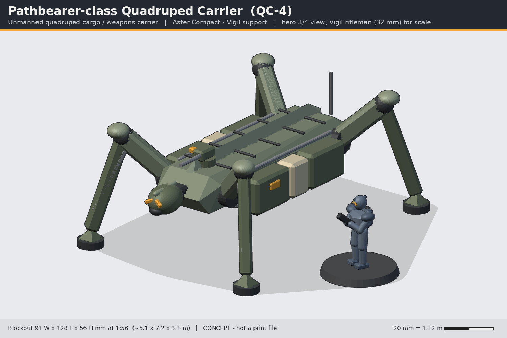
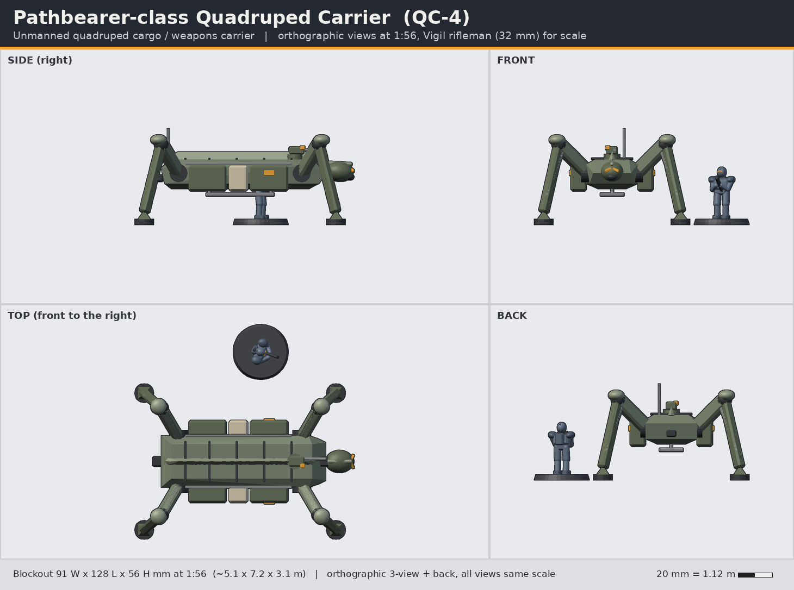

# Pathbearer-class Quadruped Carrier (QC-4)

> Status: **concept** (code-built blockout, not a print-ready sculpt). Lane: armour, walkers & drones. Aster Compact / Vigil support.

**Pitch:** A long-legged autonomous pack beast that carries the squad's ammo, mortars and wounded.

| | |
|---|---|
| Id | `armour-pathbearer-quad` |
| Designation | QC-4 |
| Role | Unmanned quadruped cargo / weapons carrier |
| Drive | quadruped walker |
| Crew | 0 (autonomous; slaved to a Vigil fireteam leader) |
| Capacity | ~2 t: 6 pannier cassettes + rail load, or 1 casualty litter underslung |
| Base | none (four 11 mm pad feet with 5x2 mm magnet pockets); optional 120 x 92 mm oval |

## Battlefield role
The Pathbearer is the fireteam's mule: an unmanned four-legged carrier that follows a Vigil team leader, carrying ammunition, heavy weapons and power cells across terrain no wheeled vehicle can cross. Pannier cassettes swap out in seconds (ammo, water, batteries, Tick drone garage), the cargo rail takes a remote weapon or a mortar battery, and a litter cradle under the belly evacuates a wounded trooper.

## Silhouette and drive
Quadruped with **high insect knees**: hips at the body side, knees above the back, long shins splaying out to pad feet. The body is long, low and flat, with a small sensor head between the forelegs. Wide and spidery where the Talus is tall and upright.

## Dimensions
| | In world | 1:56 print |
|---|---|---|
| Length (head to hitch / feet) | 7.2 m | 128 mm |
| Width over feet | 5.1 m | 91 mm |
| Height (knees) | 3.1 m | 56 mm |
| Body (hull) | 5.3 x 1.7 m | 96 x 30 mm |
Footprint: stands on its own four pad feet (each 11 mm, magnet pocket); optional 120 x 92 mm oval base.

## Design language (ties to the Vigil)
- **Keel**: a dorsal keel runs the whole length of the back - the helm crest grown into a backbone.
- **Split chevron**: the sensor head is a small Vigil egg helm with amber split-chevron lenses and its own crest - it "looks" like a trooper's head, which is how the Vigil read it on the field.
- **Plate rhythm**: pannier cassettes long-short-long (bone-coloured short cassette = medical/ID), thigh and knee plates echo the infantry greaves/knee guards.

## Modularity and kit-bash
- Cargo rail: one 3 mm dovetail along the back; Picket RWS, Hailfall mortar and autocannon gimbal all slot on.
- Picket uses the **VW-01 Lance** rifle barrel and receiver from the armory at 1:1 on a gimbal.
- Pannier cassettes are generic boxes; the Tick ground drone (drone kit) parks in the "garage" cassette variant.
- Legs are four identical leg kits (mirrored pairs) to keep the sprue small.

## Printing notes (MSLA resin, rough split)
1. Body hull (hollow, drain under belly) with keel.
2. Legs x 4 as two parts each (thigh, shin+foot), pinned at the knee; shins >= 5 mm thick to survive handling.
3. Head + neck, panniers x 6, rail weapon, litter.
Estimated resin: ~35-45 ml hollowed.

## Open questions for the owner
1. Legs: fixed pose, or knee pins that allow a few stances (walking / kneeling to load)?
2. Unmanned (current) or add an optional rider saddle for a Vigil handler?
3. Is the spidery high-knee gait right, or prefer a mammal-like (forward-knee front, backward-knee rear) leg layout?

## Loadout options
- **A (Carrier)**: Picket remote weapon (gimballed Lance-pattern rifle) on the forward rail; 6 cargo cassettes, casualty litter.
- **B (Hailfall)**: Hailfall 4-tube light mortar battery on the cargo rail; ammo cassettes.
- **C (Screen)**: twin autocannon gimbal + smoke dischargers; Tick drone garage cassettes (2 Ticks).

## Files
- `source/concept.py` - blockout generator (primitives + convex hulls, 1:56 mm, z up, faces -y) using `concepts/_tools/armour_kit.py`; writes `images/` and `blockout/armour-pathbearer-quad-blockout.stl`.
- `blockout/armour-pathbearer-quad-blockout.stl` - merged blockout mesh for proportion checks only (not printable as-is).
- Rebuild: `~/ai-stack/venvs/sculpt/bin/python concepts/armour-pathbearer-quad/source/concept.py`

All shapes are original to this line; nothing is copied from Warhammer/40k, Halo, BattleTech or any other IP.
