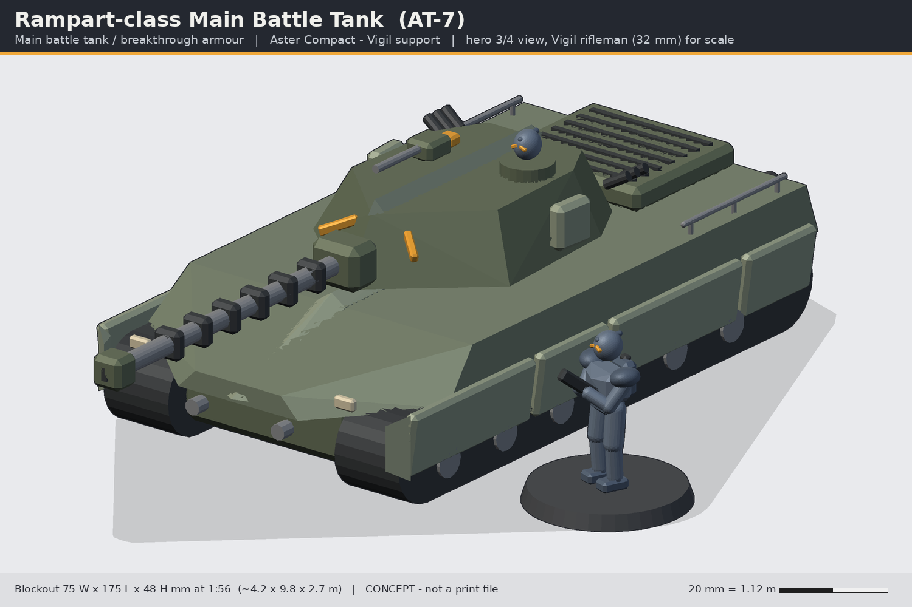
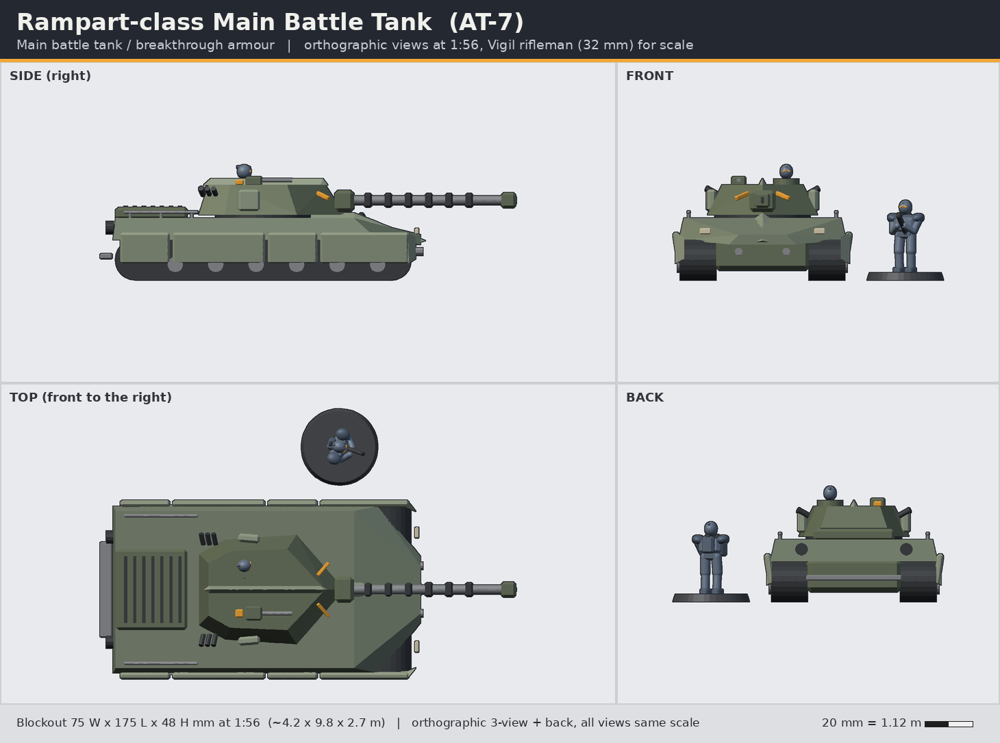

# Rampart-class Main Battle Tank (AT-7)

> Status: **concept** (code-built blockout, not a print-ready sculpt). Lane: armour, walkers & drones. Aster Compact / Vigil support.

**Pitch:** Low keel-prowed wedge with a chevron-plan turret: the line breaker the Vigil advance behind.

| | |
|---|---|
| Id | `armour-rampart-mbt` |
| Designation | AT-7 |
| Role | Main battle tank / breakthrough armour |
| Drive | tracked |
| Crew | 3 (driver, gunner, commander) |
| Capacity | desant: one 5-trooper fireteam riding on the engine-deck rails (no internal troop bay) |

## Battlefield role
The Rampart is the Aster Compact's heavy line-breaker. It leads Vigil fireteams across open ground, kills enemy armour and hard points at range, and gives infantry a rolling wall to advance behind. A fireteam can ride the engine deck (hand rails along the deck edges, rear rider step) and dismount at the objective. Its turret-rear tubes launch smoke or a Lantern Wisp recon drone (see `armour-lantern-drones`) so the tank and the squad share the same eyes.

## Silhouette and drive
Tracked. A long, low hull with the glacis running forward to a sharp **keel prow**; four armoured skirt plates per side; a set-back **chevron-plan turret** (a V nose in plan) with the gun mantlet at the point of the V. Reads at a glance as wide and planted, unlike the tall walkers or the boxy wheeled Keelwright.

## Dimensions
| | In world | 1:56 print |
|---|---|---|
| Length over gun | 9.8 m | 175 mm |
| Hull length | 7.5 m | 134 mm |
| Width over skirts | 4.2 m | 75 mm |
| Height (turret crest) | 2.7 m | 48 mm (cupola helm top) |
Footprint: hull only, no base (vehicles sit straight on the table). Optional 2 x 5x2 mm magnets in the hull belly for movement trays.

## Design language (ties to the Vigil)
- **Keel**: the sternum keel of the Kestrel cuirass becomes the hull prow ridge and continues as a raised crest along the turret roof, exactly as the trooper's keel runs into the helm crest.
- **Split chevron**: two amber sensor slits on the turret cheeks either side of the mantlet make the trooper's split chevron visor at vehicle scale; the remote station carries an amber sensor block.
- **Plate rhythm**: skirts run long-short-long-short, the same rhythm as the greave and thigh plates; plates tilt out 8 degrees and step off the hull like the exosuit plates step off the bodysuit.
- **Spine pack**: the louvred engine deck is the trooper's spine power pack, scaled.
- Slate-olive hull, bone accents (lamps), amber lenses; no skulls, no gothic, no Halo-like smooth bubble forms.

## Modularity and kit-bash
- Commander's cupola takes any **VH-01..10 helm** on the existing 1.6 mm D-flat peg (cupola socket = helm neck socket), so the tank commander matches the squad's helms.
- Remote weapon station takes the **VW-01 Lance** or **VW-05 Talon** barrel from the armory at 1:1.
- Turret ring is a 40 mm press-fit drum: turret variants A/B/C swap; the drum also fits the Keelwright crane turntable (shared part).
- Skirt plates are separate and interchangeable, so battle-damage / applique variants are cheap.

## Printing notes (MSLA resin, rough split)
1. Lower hull + track units (hollowed, 2 mm walls, drain holes in the belly) - largest part, ~135 x 75 mm, print angled ~30 degrees on a 8K 7-inch plate (fits diagonally) or split at the track units.
2. Upper hull / glacis.
3. Turret (hollow) + separate mantlet and coil-cannon barrel (barrel solid, >= 3.8 mm, print vertical).
4. Skirt plates x 8 (flat sprue), cupola, RWS, tubes, rails (rails 1.0 mm min, or swap for 1 mm brass rod).
Estimated resin: ~55-70 ml hollowed (to verify when sculpted).

## Open questions for the owner
1. Heroic tank scale: 9.8 m over gun is big next to 30 mm troopers; compress the hull to ~120 mm for table footprint?
2. Should the turret ring be magnetised (6x3 mm) so turrets swap, or press-fit only?
3. Riders on the deck: sculpt seated Vigil desant poses, or keep it as a gameplay rule only?
4. Track detail: sculpted link-by-link or a simplified band (faster to print, cleaner)?

## Loadout options
- **A (standard)**: Longwatch 120 coil cannon (sleeved coil barrel, muzzle block); coaxial Lance-pattern MG + remote weapon station.
- **B (siege)**: twin Maul-pattern heavy arc projectors (scaled VW-03); remote weapon station.
- **C (overwatch)**: Volley 8-cell missile cassette in place of the gun mantlet; coaxial MG, drone tubes.

## Files
- `source/concept.py` - blockout generator (primitives + convex hulls, 1:56 mm, z up, faces -y) using `concepts/_tools/armour_kit.py`; writes `images/` and `blockout/armour-rampart-mbt-blockout.stl`.
- `blockout/armour-rampart-mbt-blockout.stl` - merged blockout mesh for proportion checks only (not printable as-is).
- Rebuild: `~/ai-stack/venvs/sculpt/bin/python concepts/armour-rampart-mbt/source/concept.py`

All shapes are original to this line; nothing is copied from Warhammer/40k, Halo, BattleTech or any other IP.
