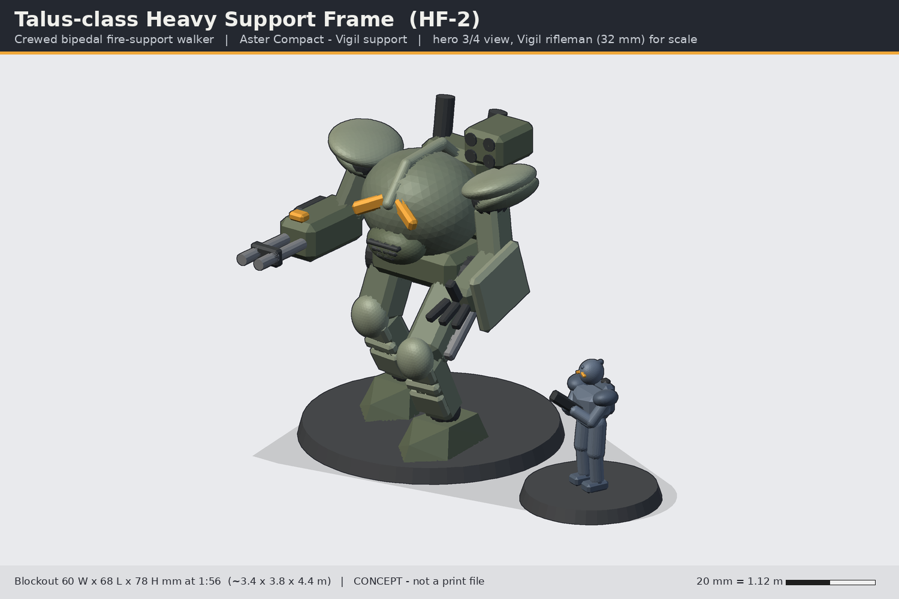
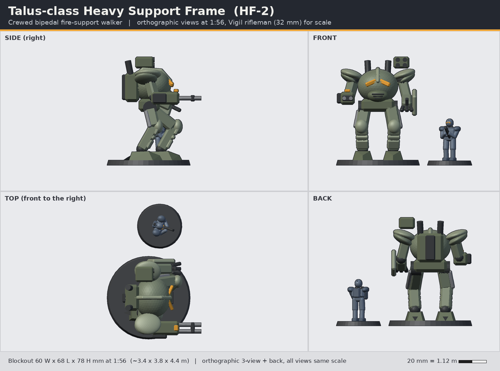

# Talus-class Heavy Support Frame (HF-2)

> Status: **concept** (code-built blockout, not a print-ready sculpt). Lane: armour, walkers & drones. Aster Compact / Vigil support.

**Pitch:** A 4 m walker whose cockpit pod is a giant Vigil helm: heavy guns that go where the fireteam goes.

| | |
|---|---|
| Id | `armour-talus-walker` |
| Designation | HF-2 |
| Role | Crewed bipedal fire-support walker |
| Drive | bipedal walker |
| Crew | 1 pilot (a Vigil in the torso pod) |
| Capacity | none; carries 2 weapon hardpoints + shoulder rack |
| Base | 60 mm round, 2 x 5x2 mm magnets |

## Battlefield role
The Talus walks with the infantry where tracks cannot: through ruins, up terraces, into breaches. One Vigil pilot sits inside the torso pod. It carries a heavy weapon on one arm and a siege claw behind a forearm shield on the other, so it can both suppress a position and physically tear open a door, barricade or bunker for the fireteam behind it. Its forearm plate doubles as mobile cover for two troopers.

## Silhouette and drive
Bipedal, forward-kneed, with chevron-toed feet and a heel spur. Tall and top-heavy: a big round torso pod over a broad pelvis, layered swept-back shoulder caps, a spine power pack with twin stacks, a missile box on one shoulder. Unmistakably different from the long low Pathbearer quadruped.

## Dimensions
| | In world | 1:56 print |
|---|---|---|
| Height (stack tops) | 4.2 m | 75 mm (78.5 mm with base) |
| Width (shoulder caps / arms) | 3.4 m | 60 mm |
| Depth (stride + gun) | 3.8 m | 68 mm |
Base: 60 mm round, 3.5 mm tall, 2 x 5x2 mm magnet pockets (same pocket spec as the 32 mm infantry bases).

## Design language (ties to the Vigil)
- **The torso is a helm**: the cockpit pod is the Vigil egg helm scaled up ~5x: split chevron viewports (amber), respirator chin with vents, and the **keel crest** running front-to-back over the top.
- **Shoulders**: layered caps that hug and sweep back (the VA shoulder cap shape), not pauldrons.
- **Plate rhythm**: greaves carry long-short-long plates; knee caps echo the VA-05 knee guard.
- **Spine pack**: the trooper's power pack becomes the walker's reactor, with twin stacks.

## Modularity and kit-bash
- Arms on 4 mm D-flat shoulder pegs: weapon arms A/B/C swap left or right.
- The Maul arc cannon variant reuses the **VW-03** form language, scaled; the pilot figure (optional, hatch-open variant) is a cut-down Vigil torso + any **VH helm** on the standard peg.
- Shoulder rack takes the missile box, smoke rack or a Wisp drone rail (shared with the drone kit cradle).

## Printing notes (MSLA resin, rough split)
1. Legs x 2 with feet (solid, 7-8 mm sections; print upright), pegged into the pelvis.
2. Pelvis + waist joint (D-flat, allows torso twist pose).
3. Torso pod (hollow, 2 mm wall, drain hole under the chin) + spine pack.
4. Shoulder caps x 2, arms x 2 (weapon arm, claw arm), missile box, stacks.
5. 60 mm base (separate, magnetised); feet have locating pins.
Estimated resin: ~30-40 ml hollowed.

## Open questions for the owner
1. Open-cockpit option (pilot visible, canopy hinged) or always sealed pod?
2. Pose: fixed stride (stronger) or ball-jointed hips for posing (weaker, more supports)?
3. Is 75 mm the right height vs the 30 mm trooper, or go taller (~90 mm) for presence?
4. Keep the claw, or offer a second heavy weapon as the default?

## Loadout options
- **A (Hammerfall)**: right arm: Hammerfall twin rotary autocannon; left arm: siege claw + Bulwark forearm plate; shoulder Volley 4-cell missile pod.
- **B (Breacher)**: right arm: Maul-pattern heavy arc cannon (VW-03 scaled x3); left arm: siege claw; shoulder smoke rack.
- **C (Overwatch)**: both arms: twin long-barrel coil rifles; shoulder: Lantern Wisp drone launch rail.

## Files
- `source/concept.py` - blockout generator (primitives + convex hulls, 1:56 mm, z up, faces -y) using `concepts/_tools/armour_kit.py`; writes `images/` and `blockout/armour-talus-walker-blockout.stl`.
- `blockout/armour-talus-walker-blockout.stl` - merged blockout mesh for proportion checks only (not printable as-is).
- Rebuild: `~/ai-stack/venvs/sculpt/bin/python concepts/armour-talus-walker/source/concept.py`

All shapes are original to this line; nothing is copied from Warhammer/40k, Halo, BattleTech or any other IP.
