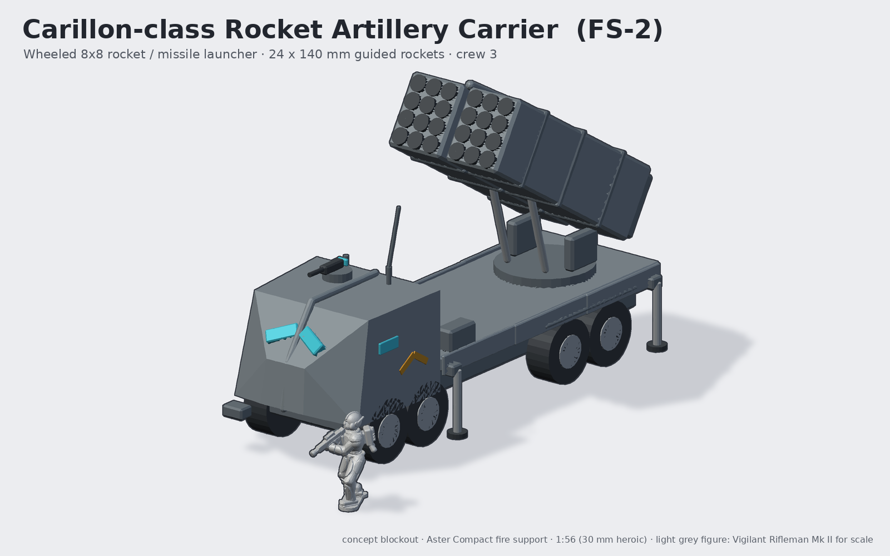
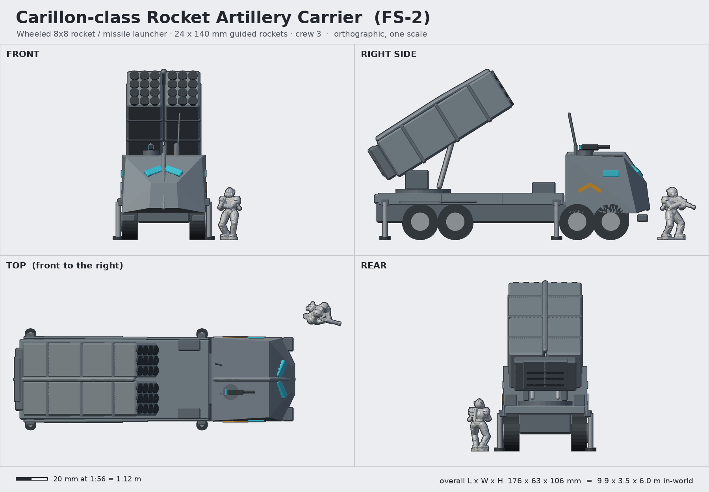

# Carillon-class Rocket Artillery Carrier (FS-2 Carillon)

**Status:** concept (blockout) · **Lane:** artillery & fire support · **Drive:** wheeled 8x8

## Role, and how it backs the Vigil
Shoot-and-scoot area fire. Where the Vesper delivers steady, accurate rounds, the Carillon empties two pods in 40
seconds to break an assault, blind a crossing with smoke, or scatter mines across an enemy approach, then drives off
on its wheels before the return fire lands. For Vigil fireteams it is the "break up that wave" card. Silhouette: a
tall wheeled truck with a big box launcher raised over an armoured chevron-nosed cab.

## Crew and capacity
- Crew 3 in the armoured cab: driver, commander (remote weapon station), launcher operator.
- One launcher load (2 pods); reloaded by the integral crane (boxes on the deck flanks) from an ammunition tender.

## Loadout variants
| Variant | Pods | Notes |
|---|---|---|
| FS-2 (standard) | 2 x 12-cell 140 mm "Peal" guided rockets | cab remote weapon station with a Lance-pattern heavy rifle |
| FS-2K Knell | 2 x 2-cell long-range "Knell" ballistic missiles | same pod shells, two big cell caps per pod |
| FS-2C Chime | 2 x 24-cell 80 mm "Chime" saturation / smoke / scatter-mine rockets | finer cell grid on the pod face |

## Key dimensions
| | In-world | At 1:56 |
|---|---|---|
| Overall length | 9.9 m | 176 mm |
| Body width | 2.9 m | 52 mm |
| Width with jacks deployed | 3.5 m | 63 mm |
| Height, launcher at 32° | 6.0 m | 107 mm |
| Height, launcher stowed (est.) | 3.3 m | 59 mm |
| Cab roof | 2.95 m | 53 mm |
| Wheels | 1.24 m dia, 0.52 m wide | 22 mm dia, 9 mm |
| Launcher pod (each) | 4.7 x 1.2 x 1.45 m | 84 x 21 x 26 mm |

Footprint: 176 x 52 mm on its wheels; no base needed.

## Design language (ties to the Vigil)
- **Split chevron:** the cab is a V prow with a two-pane windscreen in a V, split by the keel ridge running down the
  nose (the helm's visor and keel, scaled to a truck cab).
- **Keel crest:** cab roof keel; a central keel spine also runs between the two pods (it houses the elevation gear).
- **Spine pack:** the fire-control/power cell at the back of the launcher cradle is the infantry pack scaled up.
- **Plate rhythm:** three overlapping deck-side plates per side over the rear axles.
- Ochre chevrons on the cab doors; ochre ring caps on the rocket cells give a strong colour accent on the face.

## Modularity / kit-bash
- Launcher on a turntable peg (traverse free), cradle on a pin (elevation free: stowed 0° or firing 20-45°).
- Pods are separate: swap the face plate for FS-2 / 2K / 2C. Pods also fit a future static launcher emplacement.
- Remote weapon station shares the Lance receiver bits (VW family); stabiliser jacks as loose parts (deployed or stowed).
- 8x8 chassis + cab can be reused for a supply truck / ammo tender variant.

## Printing notes (MSLA resin, rough part split)
1. Chassis rail + rear deck (one part, hollow deck, drain holes).
2. Cab (hollow shell) with integral windscreen recesses; RWS separate.
3. Wheels x8 (print as two sprues of four, axles as pins into the chassis).
4. Turntable + cradle cheeks; elevation rams as loose rods.
5. Pods x2, each with a separate face plate (crisp cells; print face-up, angled).
6. Jacks x4, crane boxes x2, bumpers, antenna (antenna better as 0.8 mm brass wire).

## Open questions for the owner
- Firing pose (32°) as the default build, or stowed flat with an optional raised cradle?
- Cab-forward (current) or a lower conventional bonnet to differentiate from the troop transports of other lanes?
- 8x8 is long (176 mm): would a 6x6 at ~150 mm suit the table better?
- Should the cab share its door/window parts with the Wayfarer/Palisade-type transports being designed in other lanes?

## Design discipline (3DADA-lite, concept pass)
Advanced pole: chevron cab and keel-spined twin pods; acceptable pole: unmistakable MRL silhouette. Fixes from review:
launcher elevation was inverted in v1 (pods dipped through the deck); windscreen lenses were buried in the cab face
(raised onto the surface); big flat panels caused painter's-sort errors (render now subdivides long triangles).
Known blockout artefacts: front wheels intersect the cab skirt (wheel arches not modelled).

Shared blockout/render helpers: [`concepts/_tools/artillery_kit.py`](../_tools/artillery_kit.py) (artillery lane). Rebuild:
`~/ai-stack/venvs/sculpt/bin/python concepts/carillon-mrl/source/concept.py` (writes `images/`, `blockout/`, `concept.json`).
The light-grey figure in the renders is the real Vigilant Rifleman Mk II mesh (decimated) for scale.
