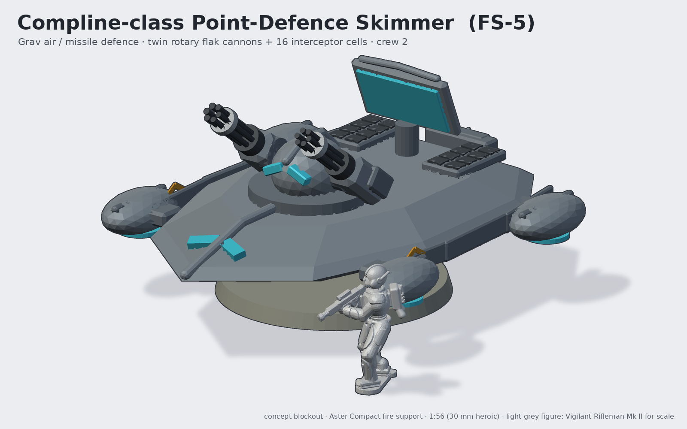
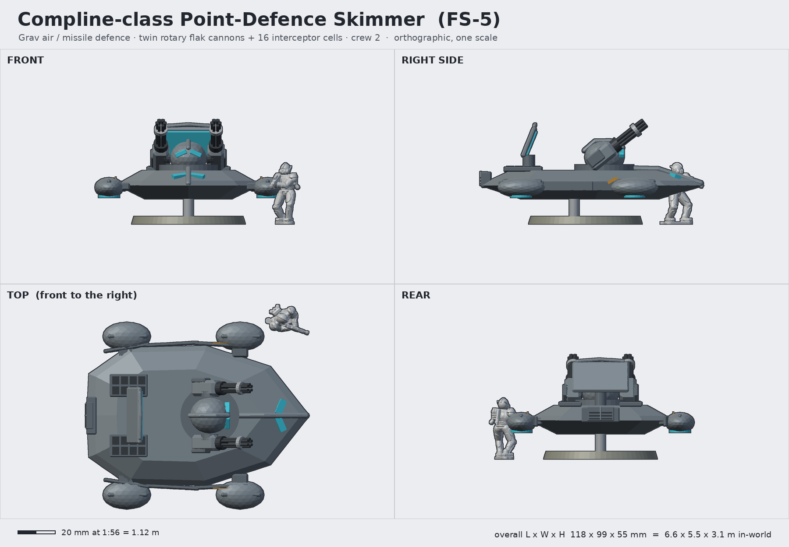

# Compline-class Point-Defence Skimmer (FS-5 Compline)

**Status:** concept (blockout) · **Lane:** artillery & fire support · **Drive:** grav (four repulsor nacelles)

## Role, and how it backs the Vigil
Air and missile defence that keeps up with the infantry. The Compline floats 0.75 m above the ground on four
repulsor nacelles, follows the fireteams over rubble and water, and guards them (and the artillery park) against
drones, rockets, shells and gunships: twin rotary flak cannons for the close-in fight, 16 vertical interceptor cells
for anything further out, cued by a tilting phased-array plate. Compline closes the canonical day: it is the last
watch, keeping the sky shut.

## Crew and capacity
- Crew 2: pilot (under the split chevron visor on the prow) and air-defence officer (in the turret dome).
- 16 interceptors in vertical cells (2 x 8), 2 x 1 800 cannon rounds.

## Loadout variants
| Variant | Turret | Notes |
|---|---|---|
| FS-5 (standard) | twin 6-barrel 30 mm "Lattice" rotary flak cannons | 16-cell "Psalter" interceptor VLS |
| FS-5L Lamplight | single pulsed-laser projector in the dome | cannon pods replaced by radiator fins |
| FS-5P Psalter | two 8-round box launchers for medium-range interceptors | VLS kept; longest reach |

## Key dimensions
| | In-world | At 1:56 |
|---|---|---|
| Hull length (prow to tail) | 6.6 m | 118 mm |
| Width over nacelles | 5.5 m | 99 mm |
| Hull width | 4.1 m | 74 mm |
| Height incl. hover gap + stand base | 3.1 m | 55 mm |
| Hover gap | 0.75 m | 13 mm (on the flight post) |
| Phased-array plate | 1.7 x 0.95 m | 30 x 17 mm |

Base: 60 mm round flight base with a 5 mm post; the post plugs into a magnetised socket in the belly so the hull lifts
off for transport.

## Design language (ties to the Vigil)
- **Split chevron:** the hull is a chevron prow in plan; the pilot's visor is two lenses in a V on the prow slope, split
  by the keel; the sensor dome carries a second chevron visor (it reads as a helmeted head between two guns).
- **Keel crest:** along the prow and over the turret dome; the phased-array plate has a crest along its top edge;
  each nacelle has its own small keel.
- **Plate rhythm:** three stepped skirt plates per side on the hull waist.
- **Spine pack:** tail-mounted power cell with the three vent slots.

## Modularity / kit-bash
- Turret ring peg: swap FS-5 / 5L / 5P turrets; the same turret could sit on the Vesper hull for a tracked SPAAG.
- Rotary cannon pods are mirrored parts; also usable as a heavy weapon for walkers in other lanes.
- Nacelles are four identical parts; could be shared with any other grav vehicle in the line (e.g. the grav carrier lane).
- Phased-array plate on a pivot pin, tilt posable.

## Printing notes (MSLA resin, rough part split)
1. Hull upper + lower (split at the waist line, hollow, drain holes in the belly where the post socket hides them).
2. Nacelles x4 + pylons (print on supports; emitter discs as a separate clear or painted part).
3. Turret ring + dome; cannon pods x2 with barrels integral (barrels 1.5 mm, heroic thick) or brass-rod option.
4. Array plate + mast; VLS deck plates x2.
5. Flight base 60 mm + post (acrylic rod 5 mm or printed).

## Open questions for the owner
- Grav (current) or a tracked/wheeled SPAAG to keep grav exclusive to other factions?
- Rotary cannons vs a cleaner energy weapon (FS-5L) as the default build?
- Hover gap: 13 mm on a post (current) or nacelles touching the base for a sturdier print?
- Should the array plate be optional (it is the most fragile part)?

## Design discipline (3DADA-lite, concept pass)
v1: the prow keel stuck out like a lance and the visor lenses floated above the hull; v2 sank the keel into the prow
and laid the chevron visor on the prow slope; the array lens had painter's speckle (now stands proud of the plate).

Shared blockout/render helpers: [`concepts/_tools/artillery_kit.py`](../_tools/artillery_kit.py) (artillery lane). Rebuild:
`~/ai-stack/venvs/sculpt/bin/python concepts/compline-point-defence/source/concept.py` (writes `images/`, `blockout/`, `concept.json`).
The light-grey figure in the renders is the real Vigilant Rifleman Mk II mesh (decimated) for scale.
