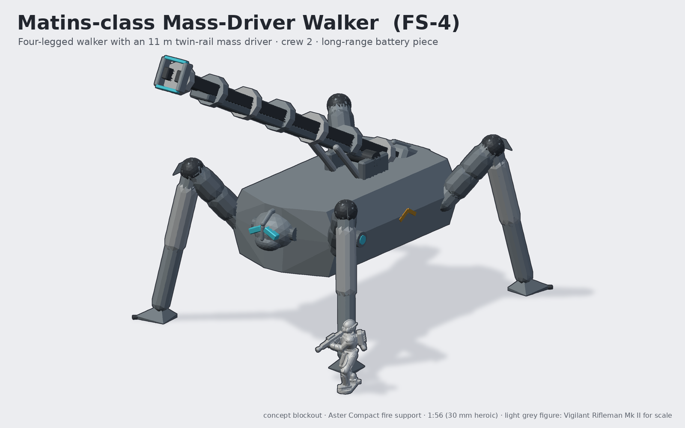
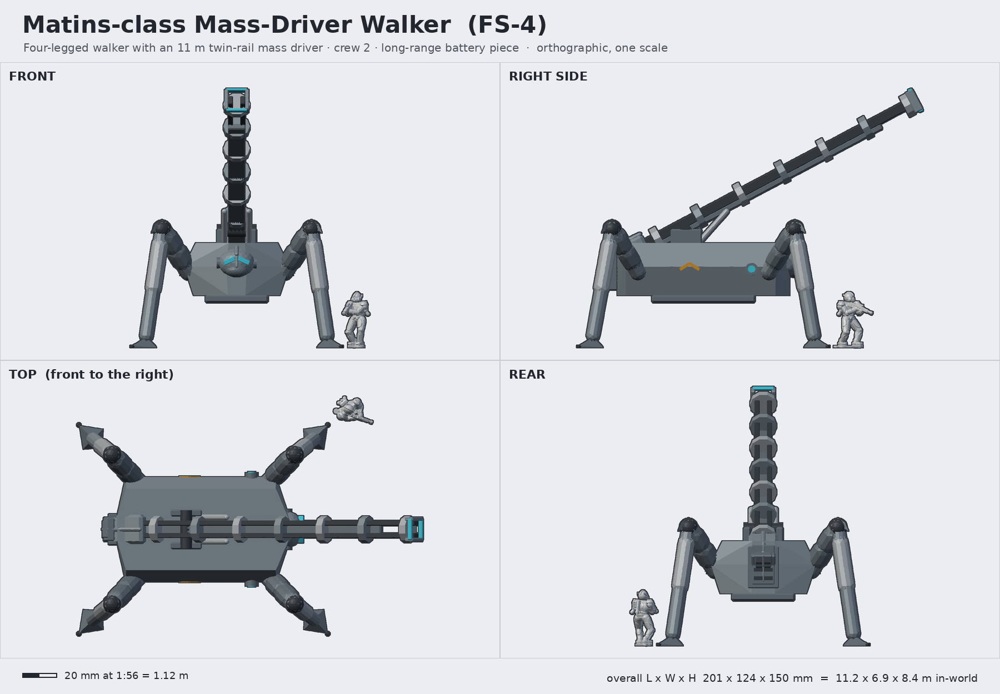

# Matins-class Mass-Driver Walker (FS-4 Matins)

**Status:** concept (blockout) · **Lane:** artillery & fire support · **Drive:** walker (four bracing legs)

## Role, and how it backs the Vigil
Theatre-depth precision fire. The Matins carries an 11 m electromagnetic mass driver on a four-legged walker that
steps into broken ground no track can cross, then plants its spade feet and fires guided slugs at command posts,
enemy artillery and landing zones more than 150 km away (or straight up at low-orbit targets). The Vigil fight an
enemy whose support has already been taken apart. As a model it is the centrepiece of the artillery park: a tall
diagonal rail over a crouched spider-like walker, unlike anything else in the line.

## Crew and capacity
- Crew 2 in the helm-shaped cab: walker pilot and battery officer.
- 18 guided slugs in the breech magazine; reactor endurance 36 h (spine-pack reactor at the rear of the body).

## Loadout variants
| Variant | Weapon | Notes |
|---|---|---|
| FS-4 (standard) | 11 m twin-rail mass driver, 40 kg guided "Matin" slugs | direct lay out to low-orbit intercept |
| FS-4S Lauds | 6 m short rail, rapid-fire 12 kg glide shells | shorter, walks with the brigade |
| FS-4R Watchtower | folding counter-battery radar mast + twin point-defence turrets | battery spotter; no rail |

## Key dimensions
| | In-world | At 1:56 |
|---|---|---|
| Overall length (rail at 28°) | 11.3 m | 201 mm |
| Width over feet (braced) | 6.9 m | 124 mm |
| Height to muzzle (28°) | 8.4 m | 151 mm |
| Body (L x W x H) | 5.6 x 3.4 x 1.7 m | 100 x 61 x 30 mm |
| Belly height | 1.7 m | 30 mm |
| Rail length | 11.0 m | 196 mm |
| Spade foot | ~1.0 m | ~18 mm |

Footprint: four feet on a 124 x 150 mm rectangle; recommended 150 x 95 mm oval or 130 mm round display base with
magnets in the feet.

## Design language (ties to the Vigil)
- **The cab is a Vigil helm:** egg-shaped cab with a respirator chin, split chevron visor, keel crest and ear pods,
  so the walker literally wears the infantry's face.
- **Plate rhythm:** thighs carry two raised armour collars; knees have pointed knee plates (the infantry knee guard VA-05).
- **Keel crest:** along the breech block of the rail; spine pack (reactor) at the back of the body and a second one
  (capacitor bank) behind the breech.
- Alternating slate / steel field-coil collars along the rail give a strong rhythm; lens-blue emitter bars at the muzzle.

## Modularity / kit-bash
- Rail on a trunnion pin: pose from 0° (travel) to ~60°; FS-4S and FS-4R swap at the trunnion.
- Legs are four identical left/right-mirrored assemblies (hip ball, thigh, knee, shin, foot) on ball joints so the
  owner can pose the walker stepping; could be reused for a walker transport.
- Cab is a scaled-up VH helm: alternative cabs from the VH library (Sentinel, Raptor, ...) scaled 3.7x.

## Printing notes (MSLA resin, rough part split)
1. Body (hollow, drain holes) with cab as a separate part (helm-style D peg).
2. Legs: thigh + shin per leg (8 parts) with ball sockets; spade feet separate with 5 x 2 mm magnet pockets.
3. Rail: split in two at a coil collar (196 mm does not fit a 7-inch plate), keyed spine beam, plus breech block and
   capacitor bank. Print rails vertically to keep them straight.
4. Trunnion cheeks + elevation rams; muzzle crown.
Heaviest kit in the lane (rough estimate 60-80 ml resin hollowed). The rail is long and top-heavy: weight the base.

## Open questions for the owner
- Is a walker right for artillery, or should the Matins be a tracked/static battery and the walker go to another role?
- Rail length vs table: 196 mm is dramatic but fragile. Shorter standard rail (8 m, 143 mm)?
- Four legs (current, braced and stable) or six for a more insectile look?
- Base: individual magnetised feet on the table vs an integral display base?

## Design discipline (3DADA-lite, concept pass)
v1 legs were spindly (7.5 m stance, knees too high) and read as a toy spider; v2 lowered the body, shortened and
thickened the legs, added knee plates and bigger spade feet. The front visor was invisible; v3 gave the walker a
Vigil helm cab, which now carries the design-language tie.

Shared blockout/render helpers: [`concepts/_tools/artillery_kit.py`](../_tools/artillery_kit.py) (artillery lane). Rebuild:
`~/ai-stack/venvs/sculpt/bin/python concepts/matins-mass-driver/source/concept.py` (writes `images/`, `blockout/`, `concept.json`).
The light-grey figure in the renders is the real Vigilant Rifleman Mk II mesh (decimated) for scale.
