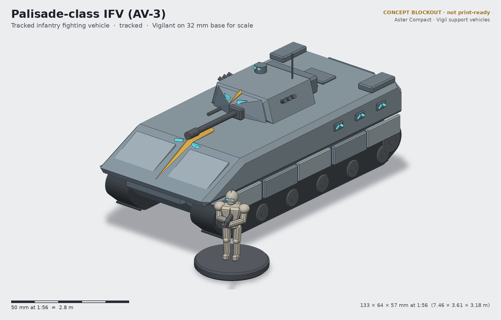
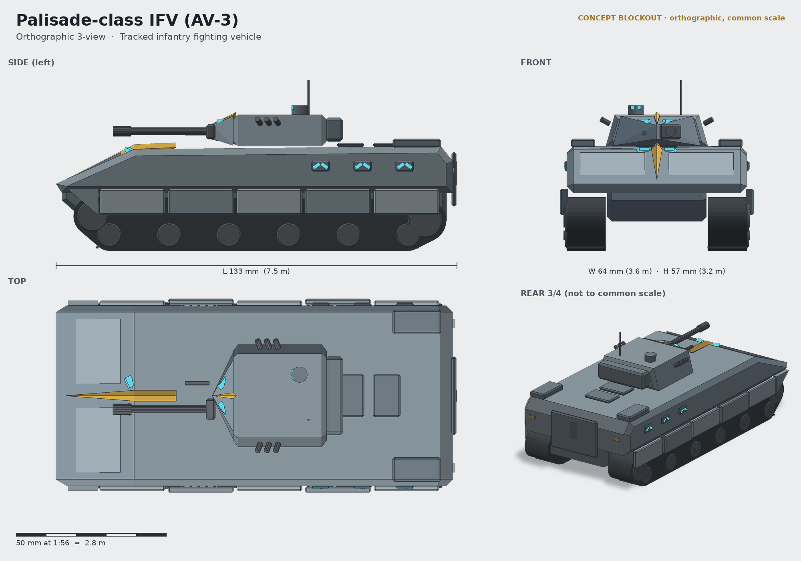

# Palisade-class IFV (AV-3)

**Status:** concept (blockout + renders, not a print-ready sculpt) · **Lane:** transport · **Drive:** tracked

## Role
The Palisade is the Vigil fireteam's own tracked fighting vehicle. It carries six Vigilants in full Kestrel exosuit to
the edge of contact, drops them out of the rear ramp, then stays as the team's fire base: the stabilised 30 mm
autocannon suppresses while the troopers move, and the hull is the hard cover they fall back to. Doctrine is "one
team, one Palisade": the vehicle commander is part of the fireteam net and the Warden sergeant can hand targets to
the gunner.

## Crew and capacity
- Crew 3: driver (hull front-left), gunner and commander (two-man turret).
- 6 Vigilants seated back to back, spine packs racked in wall cradles (packs are too deep to sit against).
- Rear power ramp; two roof hatches over the troop bay.

## Loadout options
| Variant | Main | Secondary |
|---|---|---|
| AV-3A (standard) | 30 mm Rook autocannon, dual feed | coaxial Lance-pattern repeater; 2×3 smoke/chaff dischargers |
| AV-3B Spindle | Rook + twin Spindle anti-armour missile pod on the turret left | coaxial repeater |
| AV-3W Ward | turretless; roof remote weapon station (heavy repeater) | +2 seats (8 Vigilants), command fit |

## Key dimensions
| | World | 1:56 model |
|---|---|---|
| Length (hull, gun excluded) | 7.46 m | 133 mm |
| Width over skirts | 3.61 m | 64 mm |
| Height to antenna tip / turret roof | 3.18 m / ~2.5 m | 57 mm / ~45 mm |
| Track run | ~6.9 m | ~123 mm |

Footprint about 133 × 64 mm, no base (the hull sits on its tracks), comparable to a large tabletop transport. Measured from
`blockout/palisade-ifv-blockout.stl` by `source/concept.py`.

## Design language (ties to the Vigil)
- **Keel crest:** an amber-edged spine runs up the glacis and over the roof to the turret, then continues over the
  turret nose: the sternum keel of the Kestrel cuirass and the helm crest, scaled up.
- **Split chevron:** driver vision blocks, gunner sight and the troop-bay periscopes are all pairs of lenses set in a
  V split by the keel, the same reading as the VH-01 visor.
- **Plate rhythm:** five skirt plates with gaps and alternating stand-off (the exosuit's plates-grown-off-the-body
  idea) and two raised glacis plates either side of the keel.
- Faceted, slab-sided slate hull with chamfered edges; no rivets, no gothic ornament, no rhomboid tracks.

## Modularity / kit-bash
- Turret drops into a 30 mm round turret ring (magnet 5×2 mm), so the A/B/W turret tops swap. The Ward RWS uses the
  same ring as the Wayfarer's Tally RWS.
- Rear ramp is a separate part: can be glued open or closed; open shows six seats.
- Commander hatch accepts any Vigil helm (VH-01..10) on a half-torso "hatch Vigilant" built from the exosuit kit.
- The coax and pintle repeaters can borrow the VW-01 Lance receiver as a detail donor.

## Printing notes (rough resin split)
- Lower hull + track units as one piece (hollowed, 2 mm walls, drain holes underneath) — or tracks split L/R if
  the hull is printed upright.
- Upper hull (glacis + roof) as one shell; skirts as 2 strips (one per side) with the plate rhythm.
- Turret body, mantlet + barrel (barrel ≥ 2.5 mm, print vertical), commander cupola, smoke dischargers on a sprue.
- Rear ramp; stowage bins; antenna as brass rod rather than resin.
- Biggest part ~133 × 64 mm fits an 8K 7-inch plate diagonally only if split into upper/lower hull; budget ~45–60 ml
  hollowed.

## Open questions for the owner
1. True 1:56 (133 mm long) or a compressed "heroic" vehicle scale (≈ 110 mm) to keep the table footprint down?
2. Do six seated exosuit troopers fit the lore, or should the bay be visibly taller (raises the hull ~3 mm)?
3. Should the turret be offset (Bradley-style) to free a centre aisle, or stay centred for symmetry with the keel?
4. Paintable decal area: one large plate on each side for unit markings?
