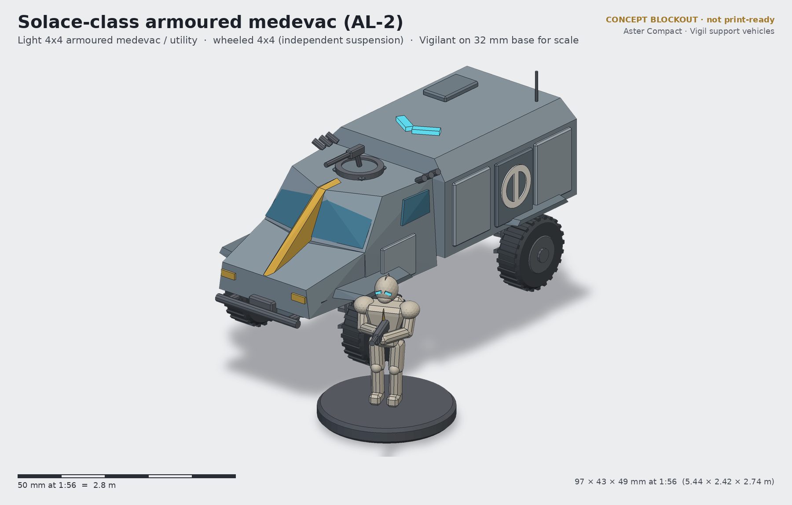
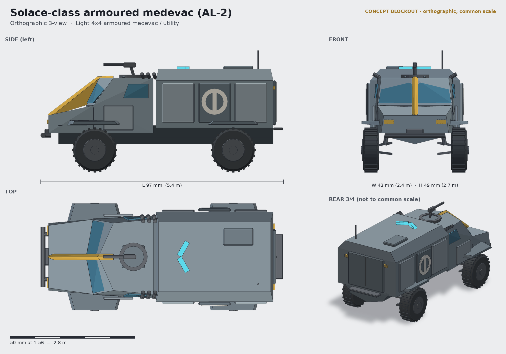

# Solace-class armoured medevac (AL-2)

**Status:** concept (blockout + renders, not a print-ready sculpt) · **Lane:** transport · **Drive:** wheeled 4×4, independent suspension

## Role
The Solace is the light runabout that follows the fireteams right up to the line. In its standard medevac fit it
recovers a downed Vigilant — exosuit and all, too heavy for a stretcher team — into an armoured litter pod and runs
them back to the aid post. Swap the rear mission pod and the same cab-forward chassis becomes a recon car or a
utility/ammo runner, so every Vigil platoon keeps a couple of them. On the table it is a small, cheap support
model: objective carrier, casualty-recovery mechanic, or recon screen.

## Crew and capacity
- Crew 2: driver and medic/commander (roof ring mount).
- 2 armoured litters for suited casualties + 1 medic; or 4 seated Vigilants in the utility pod.

## Loadout options
| Variant | Main | Secondary |
|---|---|---|
| AL-2M Solace (medevac) | cab-roof light repeater on a ring mount | smoke dischargers; no offensive fit under the aid marking |
| AL-2R Outrider (recon) | open bed with telescopic sensor mast + twin Spindle anti-armour missiles | light repeater |
| AL-2U Wick (utility) | cargo/ammo pod with crane arm; pintle heavy repeater | smoke |

## Key dimensions
| | World | 1:56 model |
|---|---|---|
| Length (incl. bull bar and step) | 5.44 m | 97 mm |
| Width over wheels | 2.42 m | 43 mm |
| Height to antenna / pod roof | 2.74 m / ~2.3 m | 49 / 41 mm |
| Wheel diameter | 0.96 m | 17.2 mm |
| Wheelbase | 3.1 m | 55.5 mm |

Footprint about 97 × 43 mm; no base.

## Design language
- **Split chevron windscreen:** two panes swept back in a V around a forward keel pillar, which continues as the keel
  crest down the bonnet: the vehicle wears the VH-01 face.
- **Chevron beacon:** the roof light bar is a lens V.
- **Plate rhythm:** three pod-side plates, the middle one recessed for the Compact aid marking (an original open ring
  with a vertical lamp bar — not a red cross/crescent, to stay neutral and original).
- High-riding cab-forward truck with exposed wishbones: the smallest and most "civil" silhouette in the lane.

## Modularity / kit-bash
- Rear mission pod plugs onto the chassis on two pegs: medevac pod, open recon bed, utility pod — the main kit-bash
  point. The AG-5L Tern can sling-lift the pod.
- Roof ring mount takes the Tally repeater from the Wayfarer RWS or a VW-03 Maul arc-cannon for a "technical" look.
- Litter casualty = a Vigilant from the exosuit kit in a lying pose (good use for spare bodies).

## Printing notes (rough resin split)
- Chassis tub + bonnet; cab shell (hollow); rear pod (hollow, separate); 4 wheels (one part ×4); 4 wishbone sets on a
  sprue; bull bar + winch; ring mount + repeater; light bar.
- Fits an 8K 7-inch plate in one go; budget ~20–25 ml hollowed.

## Open questions for the owner
1. Medevac as the box default, or recon (more table use)?
2. Aid marking: keep the ring-and-bar symbol, or define a faction-wide medic glyph for infantry pauldrons too?
3. Should the pod open (rear clamshell posed open with a litter sliding out)?
