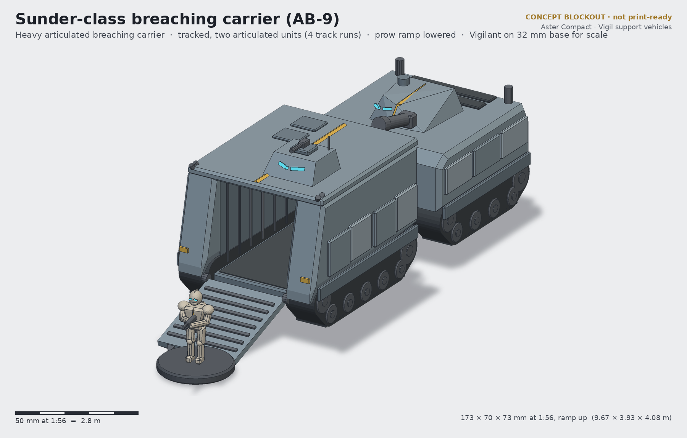
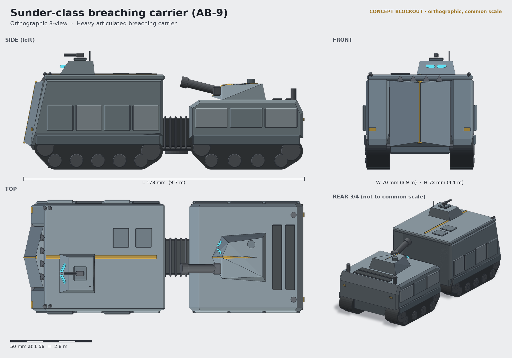

# Sunder-class breaching carrier (AB-9)

**Status:** concept (blockout + renders, not a print-ready sculpt) · **Lane:** transport · **Drive:** tracked, two articulated units (4 track runs)

## Role
The Sunder is the Vigil's door-kicker. Its tall assault module is armoured for a frontal approach: it noses straight
into a breach (bunker wall, hab airlock, barricade), drops the chevron-prowed ramp, and puts a full assault section
out of the **front**, under its own armour, instead of exposing them on the flank. The rear power unit stays a few
metres back behind the articulation joint and fires its short demolition gun over the module's roof. Pairs naturally
with Breacher-helm (VH-03) and Bulwark-helm (VH-09) Vigilants armed with the Halberd shotgun (VW-07) and Brand flamer
(VW-06).

## Crew and capacity
- Crew 3: driver and commander in the armoured roof cab on the assault module (chevron vision slits); gunner in the
  rear-unit turret.
- 10 Vigilants standing-ready on grab rails; interior ~2.1 m high and ~2.1 m wide, walkable in exosuit.

## Loadout options
| Variant | Main | Secondary |
|---|---|---|
| AB-9A (standard) | Cleaver 90 mm short demolition gun in the rear-unit turret | cab-roof grenade launcher; prow-mounted smoke mortars |
| AB-9T Torch | twin Hearth thermal lances in the rear turret (short-range bunker clearing) | as standard |
| AB-9H Hold | 30 mm Rook autocannon turret + point-defence laser on the cab | assault module seats 12 |

## Key dimensions
| | World | 1:56 model |
|---|---|---|
| Overall length, ramp up (incl. breaching teeth) | 9.67 m | 173 mm |
| Assault module / power unit length | 4.5 m / 3.9 m | 80 / 70 mm |
| Width over tracks + plates | 3.93 m | 70 mm |
| Height to antenna / cab roof / module roof | 4.08 m / ~3.7 m / ~3.2 m | 73 / 66 / 58 mm |
| Ramp (lowered) | 2.3 m long, 2.1 m wide | 41 × 37 mm |

Footprint about 173 × 70 mm (ramp up), ~210 mm with the ramp down.

## Design language
- **Chevron prow:** the ramp is two armoured leaves meeting at a raised keel ridge, so the vehicle's face *is* a split
  chevron; four breaching teeth on the top edge become the ramp's toe when lowered.
- **Keel crest** along the module roof and over the turret nose; chevron vision slits on cab and turret.
- **Plate rhythm:** four heavy sponson plates per side on the module, three on the power unit, alternating stand-off.
- Two-body articulated layout with a bellows joint: deliberately unlike a single-hull rhomboid assault tank; no
  sponson guns, no side doors.

## Modularity / kit-bash
- The two units are separate models joined by a magnetised articulation pin, so the table can pivot them (or field
  the assault module alone as a breaching objective / bunker).
- Ramp on a pin hinge: open or closed (both shown in the renders).
- Rear turret uses the 30 mm ring standard, so Palisade/Wayfarer turrets can drop in (that is the AB-9H variant).
- Grab rails and benches inside take seated/standing Vigilants; interior is the showcase when the ramp is down.

## Printing notes (rough resin split)
- Assault module: floor pan, two side sponsons (with plates), roof + cab, rear wall: print as an open box (no hollowing
  needed, walls 2–3 mm) or in 4 plates for a cleaner interior.
- Ramp (with teeth) separate, hinge pins 1.5 mm brass.
- Power unit: lower hull + upper deck (hollow), turret, gun (print vertical), exhaust stacks.
- 4 track units (2 per unit) as separate parts, or integrated into the side sponsons.
- Articulation joint + bellows as one part; 6×3 mm magnet in the pin.
- Budget ~90–110 ml: the largest concept of the lane.

## Open questions for the owner
1. Articulated (two models) or a single long hull? Articulated is more original but more parts.
2. Is 4.1 m height acceptable on the table (the module is taller than an exosuit trooper by ~1.5x)?
3. Should the ramp also open as a two-leaf visor (leaves swing sideways) instead of dropping, to sell the chevron?
4. Demolition gun vs thermal lances as the default box contents?
