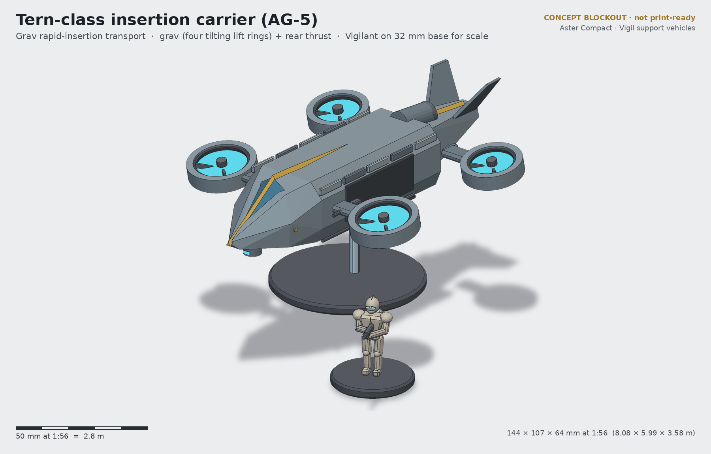
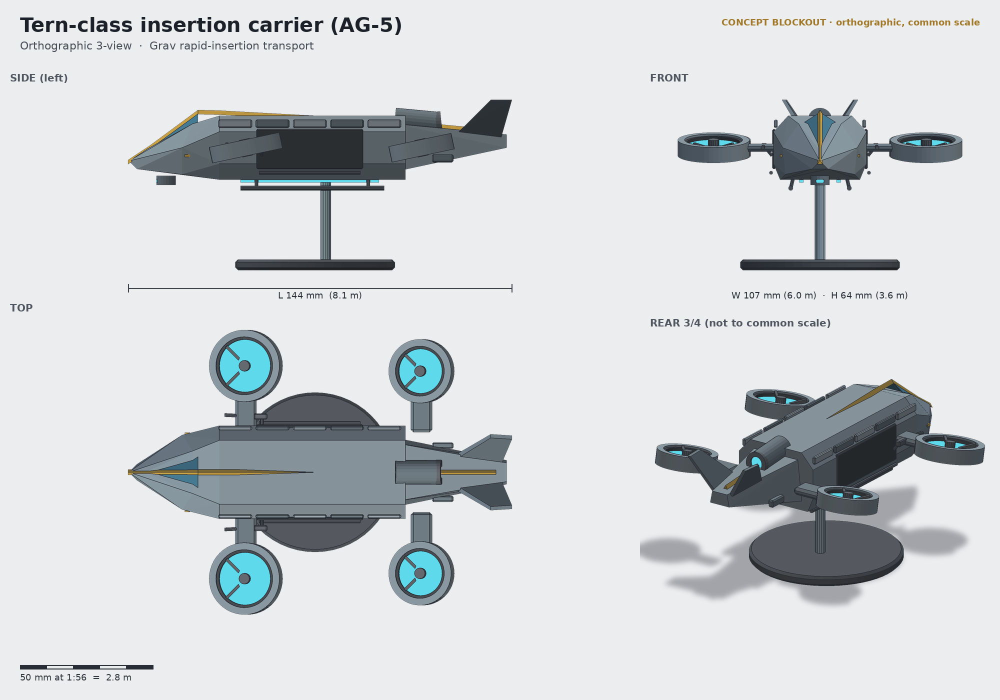

# Tern-class insertion carrier (AG-5)

**Status:** concept (blockout + renders, not a print-ready sculpt) · **Lane:** transport · **Drive:** grav (four tilting lift rings) + rear thrust

## Role
The Tern is how the Vigil "keep watch from orbit" in practice: a grav skimmer that comes in low under sensor cover,
hovers a metre off the ground with both side doors open, and lets a fireteam drop off the rails in seconds. Door
gunners (two of the squad) cover the landing zone; the Tern lifts away and loiters as a gun platform or comes back
for extraction. It is the fastest way to put a Warden-led team on an objective, and the one transport that ignores
terrain.

## Crew and capacity
- Crew 2: pilot and systems officer under a split chevron canopy.
- 8 Vigilants in full exosuit on drop rails, four per side; two of them take the door repeaters.

## Loadout options
| Variant | Main | Secondary |
|---|---|---|
| AG-5A (standard) | 2 pintle heavy repeaters in the side doors | chin sensor turret, flare/chaff pods |
| AG-5G Gale | chin-mounted rotary repeater + 2 stub-wing rocket pods (troops reduced to 6) | door repeaters |
| AG-5L Lift | unarmed cargo/sling variant: belly winch for a Solace pod or supply crate | flare pods only |

## Key dimensions
| | World | 1:56 model |
|---|---|---|
| Length | 8.08 m | 144 mm |
| Span over lift rings | 5.99 m | 107 mm |
| Airframe height (skids to fin tips) | ~1.9 m | ~33 mm |
| Height on flight stand | — | 64 mm (belly at 34 mm) |
| Lift ring diameter | 1.5 m (front) / 1.3 m (rear) | 27 / 24 mm |

Footprint: 60 mm round flight base, clear 4 mm rod into a belly socket (magnet in the base, 5×2 mm).

## Design language
- **Split chevron canopy:** two glazed panes meeting in a V, divided by the keel spine: the VH-01 visor at airframe
  scale, readable from the front and top.
- **Keel crest** runs from the nose over the canopy and down the dorsal spine to the twin canted fins.
- **Plate rhythm:** five alternating plates over the door line; open door bays read as dark slots.
- Glowing lift rings use the same lens colour as visors and vision blocks (one emissive colour across the line).
- No rotors, no wings: four ring ducts on stub pylons give a silhouette unlike the tracked and wheeled carriers.

## Modularity / kit-bash
- Lift rings are one part ×4 on a keyed pylon socket; they can be posed tilted (cruise) or level (hover).
- Door repeaters are separate pintles; door gunners are standard Vigilants with a kneeling pose (Marksman legs) and a
  repeater swapped for the rifle.
- Flight-stand socket is a 4 mm round hole, so the Tern can also sit on its skids on the table.
- AG-5L winch can lift the Solace medevac rear pod: a cross-lane gag that also works as an objective marker.

## Printing notes (rough resin split)
- Fuselage in two halves split on the centreline (hollow, 1.8 mm), canopy as clear resin (optional) or painted.
- Tail boom + fins as one piece; 4 lift rings + 4 pylons; skids; door repeaters on a sprue; chin turret.
- Flight base and rod: base printed flat, rod as acrylic rod rather than resin.
- Budget ~35–45 ml hollowed.

## Open questions for the owner
1. The troop bay is only ~1.35 m tall inside (24 mm): accept "drop-rail seats" or raise the fuselage ~5 mm?
2. Clear canopy (separate clear-resin part) or solid painted glazing?
3. Should the rings tilt on a pin joint (posable) or be fixed at 12°?
