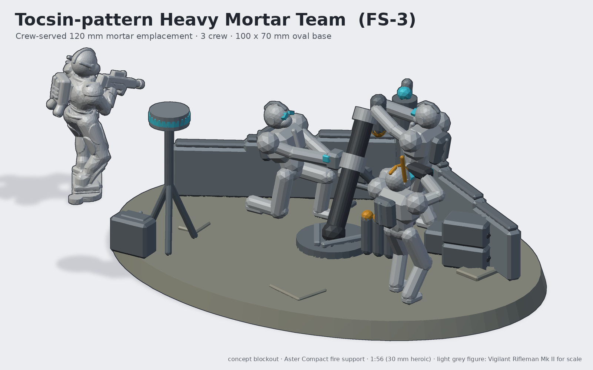
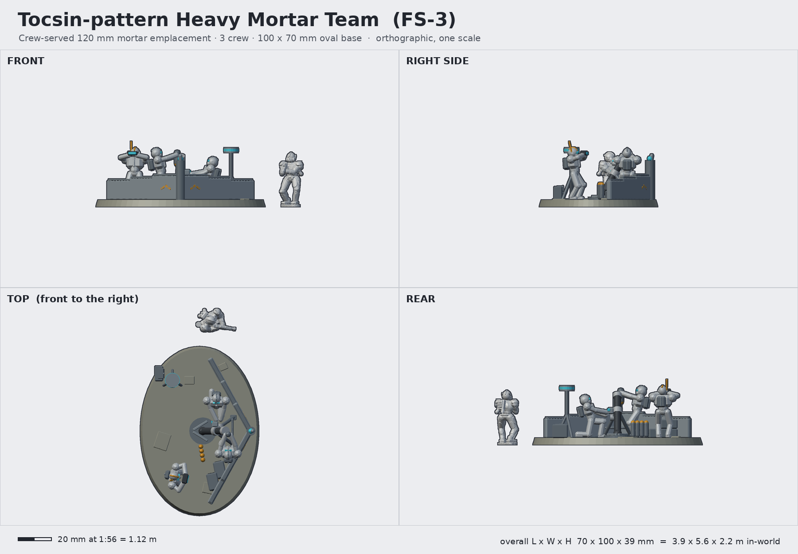

# Tocsin-pattern Heavy Mortar Team (FS-3 Tocsin)

**Status:** concept (blockout with 3 crew figures) · **Lane:** artillery & fire support · **Drive:** emplacement (crew-served)

## Role, and how it backs the Vigil
The company's own artillery. Three Vigilants carry a 120 mm mortar forward in pieces, set it up behind a folding
chevron "ward wall" and drop smoke, HE and illumination within 7 km, usually within sight of the fireteams they
support. It is the fire-support unit that is *also infantry*: same armour, helms and packs, so it sits in the squad
visually. A small "tocsin" acoustic/radar puck on a tripod gives counter-battery warning (the alarm bell of the name).

## Crew and capacity
- Crew 3 (all on one base): **loader** standing at the muzzle with a round, **gunner** kneeling at the sight and
  traverse wheel, **section leader** (Warden helm with whip antenna) calling corrections through a rangefinder.
- 12 ready rounds (4 standing, 8 in the crate stack).

## Loadout variants
| Variant | Weapon | Notes |
|---|---|---|
| FS-3 (standard) | 120 mm smoothbore "Tocsin" mortar on a chevron-ribbed baseplate | bipod, sight unit, elevation screw |
| FS-3G Tocsin Guided | 4-canister launcher for "Lark" loitering munitions on the same baseplate | gunner holds a control slate |
| FS-3A Twin Toll | twin 81 mm auto-mortar on a tripod with clip feed | loader swaps to a magazine-carrying pose |

## Key dimensions
| | In-world | At 1:56 |
|---|---|---|
| Base | 5.6 x 3.9 m | 100 x 70 mm oval, 4 mm thick |
| Mortar tube | 1.5 m, 0.22 m dia | 27 mm, 4 mm dia (heroic) |
| Baseplate | 0.9 m dia | 16 mm |
| Ward wall height | 0.8 m | 14 mm (stepped down to 11 mm) |
| Tallest element (Warden antenna) | 2.2 m | 39 mm |
| Crew figure | standard Vigilant | ~32.5 mm to the crown standing |

## Design language (ties to the Vigil)
- **Split chevron:** the ward wall itself is a V opening forward (a chevron in plan) with a keel post and lens at the
  apex; the baseplate has V ribs.
- **Keel crest / plate rhythm:** each wall arm is three stepped plates with capping strips, the same layered rhythm as
  the shoulder caps; the field power cell is a miniature spine pack.
- The crew *are* Vigilants: exosuit, keel-crested helms, split chevron visors, spine packs, so they share the
  infantry's bits directly.

## Modularity / kit-bash
- Crew built from the exosuit kit (tools/exosuit.py) with new poses; helms on the standard 1.6 mm D-flat peg (any VH
  helm), packs on the 2.0 mm pack peg, so a Warden or Breacher helm drops straight in.
- The mortar, crates, rounds and tripod mast are loose bits that could also ride on the Vesper's rear deck or on a
  transport.
- Wall arms are separate: buy two kits and you have a longer firebase wall (also usable as terrain).
- Crew on their own integral footplates keyed into recesses in the oval base (same system as the 32 mm infantry bases),
  so they can be removed and used as casualty markers / based singly on 32 mm bases with 5 x 2 mm magnets.

## Printing notes (MSLA resin, rough part split)
1. Oval base (100 x 70 x 4 mm) with three crew recesses, mortar seat, three 5 x 2 mm magnet pockets; print flat.
2. Crew figures x3: body + helm + pack each (the line's standard three-part split); the loader's round is part of his hands.
3. Mortar: tube + bipod as one part, baseplate separate; sight unit separate.
4. Wall arms x2 (print upright on supports, hollow not needed at 3 mm thick).
5. Bits sprue: crates, ready rounds, rangefinder, tripod mast + puck, power cell.

## Open questions for the owner
- Base size: 100 x 70 oval (current) or a 60 mm round with just mortar + 2 crew and the third on a 32 mm base?
- Wall: chevron arms (current), sandbag-style modular blocks, or none (open emplacement reads better from the front)?
- Should the crew be fully posed sculpts in the exosuit kit next, or kept as conversions of existing figures?
- Is 120 mm right, or should the infantry-portable piece be lighter (81 mm) and the 120 mm go on a vehicle?

## Design discipline (3DADA-lite, concept pass)
v1 hero was rendered from the front and the wall hid the team; the hero now looks over the crew's shoulder (rear 3/4)
and the wall was dropped from 1.0 m to 0.8 m. Crew are mannequin blockouts (capsules + helm with crest/visor) at the
exosuit proportions, not final sculpts.

Shared blockout/render helpers: [`concepts/_tools/artillery_kit.py`](../_tools/artillery_kit.py) (artillery lane). Rebuild:
`~/ai-stack/venvs/sculpt/bin/python concepts/tocsin-mortar-team/source/concept.py` (writes `images/`, `blockout/`, `concept.json`).
The light-grey figure in the renders is the real Vigilant Rifleman Mk II mesh (decimated) for scale.
