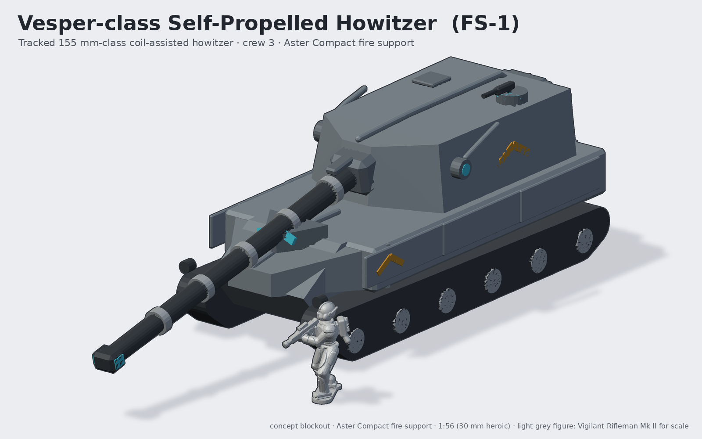
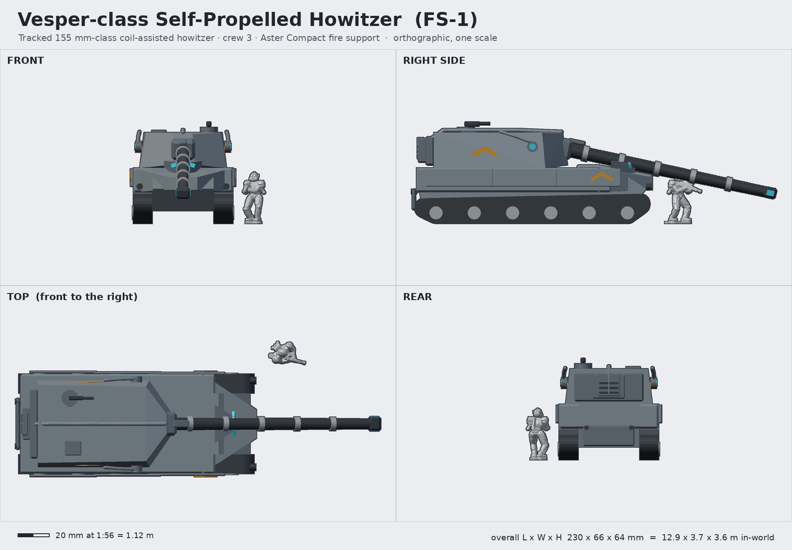

# Vesper-class Self-Propelled Howitzer (FS-1 Vesper)

**Status:** concept (blockout, not a print-ready sculpt) · **Lane:** artillery & fire support · **Drive:** tracked

## Role, and how it backs the Vigil
The Vesper is the Aster Compact's line gun. A Vigil fireteam's Warden calls a fire mission over the comms pack;
a Vesper battery 10 to 40 km back answers within a minute with HE, smoke or illumination, then moves before
counter-battery fire arrives. On the tabletop it is the "off-table on-call barrage" made physical: a big, low,
long-gunned tracked silhouette that reads instantly as artillery, not a tank (rear-set turret, very long tube, no
coaxial weapons).

## Crew and capacity
- Crew 3: driver (hull, under the chevron hood), commander (left cupola), gunner; the bustle autoloader replaces a loader.
- 40 ready rounds in the bustle autoloader cell (the vehicle's "spine pack").

## Loadout variants
| Variant | Main | Notes |
|---|---|---|
| FS-1 (standard) | 155 mm-class coil-assisted howitzer, 7.4 m tube with four coil bands | pintle Lance-pattern heavy rifle on the commander's cupola |
| FS-1L Long Vesper | extended tube with a fifth coil band, rocket-assisted shells | same turret; separate barrel sprue |
| FS-1B Bell | short 210 mm siege mortar-howitzer, fat muzzle, bunker / urban work | short barrel keeps it inside a 150 mm footprint |

## Key dimensions
| | In-world | At 1:56 |
|---|---|---|
| Hull length | 8.2 m | 146 mm |
| Overall length (gun forward, 12° elevation) | 12.9 m | 230 mm |
| Width over skirts | 3.7 m | 66 mm |
| Height (to cupola weapon) | 3.6 m | 64 mm |
| Hull deck height | 1.95 m | 35 mm |
| Turret (L x W x H) | 4.7 x 3.05 x 1.25 m | 84 x 54 x 22 mm |
| Barrel (exposed) | ~7.4 m | ~132 mm |

Footprint: hull on its tracks, 146 x 66 mm; no base (vehicle sits on the table), optional 170 x 105 mm oval
display base. Measured envelope: see \`concept.json\`.

## Design language (ties to the Vigil)
- **Split chevron:** the driver's hood carries two lenses in a V split by the hull keel; the glacis is a V prow (the
  chevron seen from above) and the turret front is a chevron wedge around the mantlet.
- **Keel crest:** a rounded ridge runs from the nose over the hull and continues along the turret roof, exactly like the
  sternum keel that becomes the helm crest on the infantry.
- **Plate rhythm:** side skirts are three overlapping plates stepping outboard (the layered shoulder caps).
- **Ear pods:** turret cheeks carry the helm's ear-pod sensors with swept fins (fire-control radar / met sensors).
- **Spine pack:** the bustle autoloader is the infantry power pack scaled up: cell block, keel spine, three vent slots.
- Ochre painted chevrons on the turret and skirts follow the infantry's marking style.

## Modularity / kit-bash
- Turret on a 12 mm D-flat turret ring peg (same keying idea as the infantry helm peg) so FS-1 / 1L / 1B swap.
- Barrel is a separate part keyed into the mantlet: three barrel sprues for the three variants.
- Cupola weapon = the armory Lance receiver scaled 1.4x (shares VW-01 shapes); commander can be a Vigil torso with any
  VH helm on the standard 1.6 mm helm peg.
- Running gear and hull shared with any future tracked chassis in the line (ammo carrier, engineer vehicle).

## Printing notes (MSLA resin, rough part split)
1. Hull tub (lower hull + sponsons): print hollow, 2 mm walls, drain holes in the belly; ~10 ml.
2. Glacis/hood + upper deck: separate plate so the V prow prints crisp.
3. Track units x2 (left / right) with road wheels integral; print upright on supports.
4. Skirt plates: 3 per side as loose plates (crisp overlaps) or one sprue per side.
5. Turret shell (hollow) + bustle autoloader + cupola.
6. Barrel + muzzle brake (print vertically, muzzle up, to keep it straight); mantlet.
7. Small bits: ear pods, cupola weapon, tow eyes, spade.
Approximate size fits an 8K 7-inch plate per part; the barrel (132 mm) needs a 10-inch class printer or a joint at
the second coil band (hide the seam under a band).

## Open questions for the owner
- Rear-set turret (current) or mid-set? Rear-set reads "artillery" but makes the hull feel long at 230 mm overall.
- Should the barrel be split at a coil band to fit 7-inch printers?
- Crew figure in the cupola (bust) included in the kit, or bare hatch?
- Keep 155 mm-class "coil-assisted" fluff, or go pure railgun to differentiate from the Matins?
- Display base or bare hull on the table?

## Design discipline (3DADA-lite, concept pass)
Mode: Adaptive (product for a hobby audience). Advanced pole: coil-banded tube and chevron prow; acceptable pole:
unmistakable SPH silhouette (long gun, big rear turret, tracks). Critic notes acted on: driver visor was invisible in
v1 (moved onto a raised hood); turret-side fins read as handles (lowered); chevron markings too small (enlarged).
Not done: full panel rounds, printability checks (this is not print geometry).

Shared blockout/render helpers: [`concepts/_tools/artillery_kit.py`](../_tools/artillery_kit.py) (artillery lane). Rebuild:
`~/ai-stack/venvs/sculpt/bin/python concepts/vesper-sph/source/concept.py` (writes `images/`, `blockout/`, `concept.json`).
The light-grey figure in the renders is the real Vigilant Rifleman Mk II mesh (decimated) for scale.
