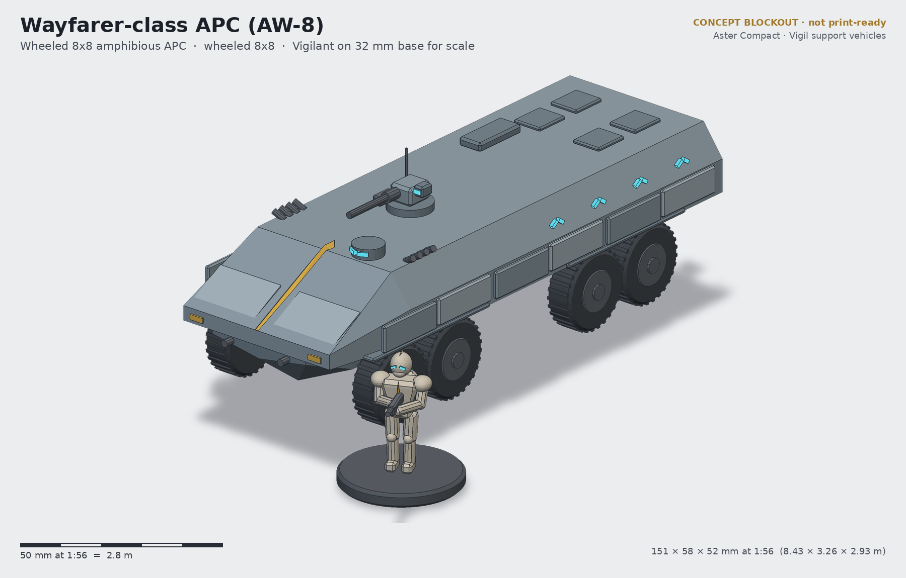
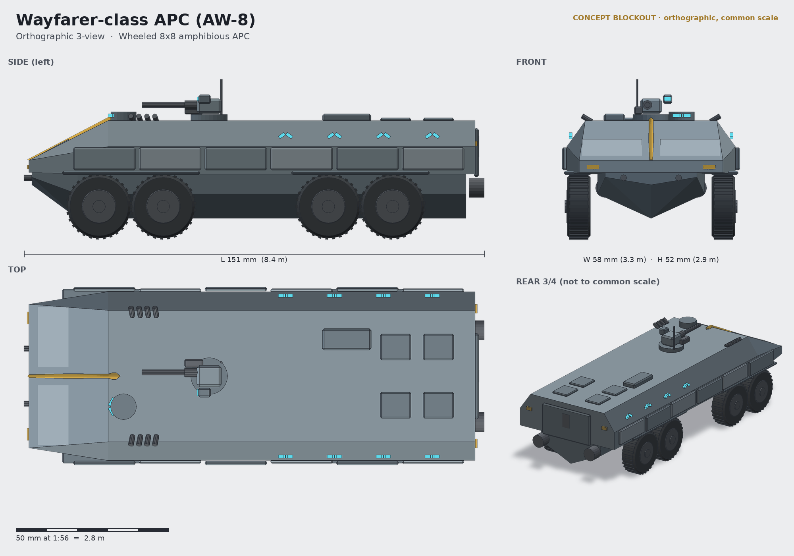

# Wayfarer-class APC (AW-8)

**Status:** concept (blockout + renders, not a print-ready sculpt) · **Lane:** transport · **Drive:** wheeled 8×8

## Role
The Wayfarer is the Compact's road-and-river battle taxi: fast on colony causeways, amphibious with two stern
waterjets, and big enough for a full Vigil section of ten. It is not meant to slug it out; it runs the section to a
covered drop point, opens the stern ramp, and backs off to overwatch with its remote weapon station. Where the
Palisade fights alongside one fireteam, the Wayfarer moves the whole section and its sergeant.

## Crew and capacity
- Crew 2: driver (front-left cupola with split chevron vision blocks) and commander/RWS operator.
- 10 Vigilants on two inward-facing benches of five; stern power ramp; four roof hatches.

## Loadout options
| Variant | Main | Secondary |
|---|---|---|
| AW-8A (standard) | Tally remote weapon station: heavy repeater + 40 mm grenade launcher | 2×4 smoke dischargers |
| AW-8C Wren | low-profile two-seat turret, 25 mm Wren autocannon (troops reduced to 8) | coaxial repeater |
| AW-8M Sling | twin-tube 120 mm breech-loaded mortar module in the troop bay (roof doors) | Tally RWS retained |

## Key dimensions
| | World | 1:56 model |
|---|---|---|
| Length | 8.43 m | 151 mm |
| Width over wheels / applique | 3.26 m | 58 mm |
| Height to antenna tip / hull roof | 2.93 m / ~2.2 m | 52 mm / ~39 mm |
| Wheel diameter | 1.16 m | 20.8 mm |
| Axle spacing | 1.2 m within pairs, 3.0 m between pairs | 21 / 54 mm |

Footprint about 151 × 58 mm; no base.

## Design language
- **Blast chevron:** the belly is a deep V in section; seen head-on the hull reads as a chevron, the vehicle-scale
  echo of the visor.
- **Keel crest** up the long glacis to the driver's cupola; trim vane folded flat either side of it.
- **Plate rhythm:** six side applique plates in alternating stand-off, fender lips over the paired wheels.
- Firing-port periscopes are pairs of slanted lenses (chevrons) along the troop bay.
- Boat hull with tumblehome sides: clearly different from the slab-sided tracked Palisade.

## Modularity / kit-bash
- Tally RWS sits on the same 30 mm magnetised ring as the Palisade AV-3W, so turrets/RWS swap between both hulls.
- Wheels are a single part ×8 (one mould, print 8 on one plate), hub keyed on a D-flat axle stub.
- Stern ramp separate (open/closed). Roof hatches separate for open-hatch Vigilants.
- Mortar variant reuses the roof hatch openings; the mortar tubes can borrow the Tocsin mortar team bits if the
  artillery lane's kit lands.

## Printing notes (rough resin split)
- Lower V hull, upper hull shell (hollow, 2 mm), 8 wheels, 2 fender/applique strips, RWS (base, cradle, barrel),
  driver cupola, ramp, waterjets on a sprue.
- Long hull (151 mm) needs a split on a 7-inch plate: split upper hull at the RWS ring line (hidden by the ring).
- Budget ~55–70 ml hollowed.

## Open questions for the owner
1. Amphibious (waterjets, trim vane) as lore flavour, or drop it for a cleaner rear?
2. Ten troopers in exosuit on benches is tight in 3.26 m width: accept heroic licence or lengthen the bay?
3. Should the wheel tread be chunkier (sci-fi) or stay near-modern?
