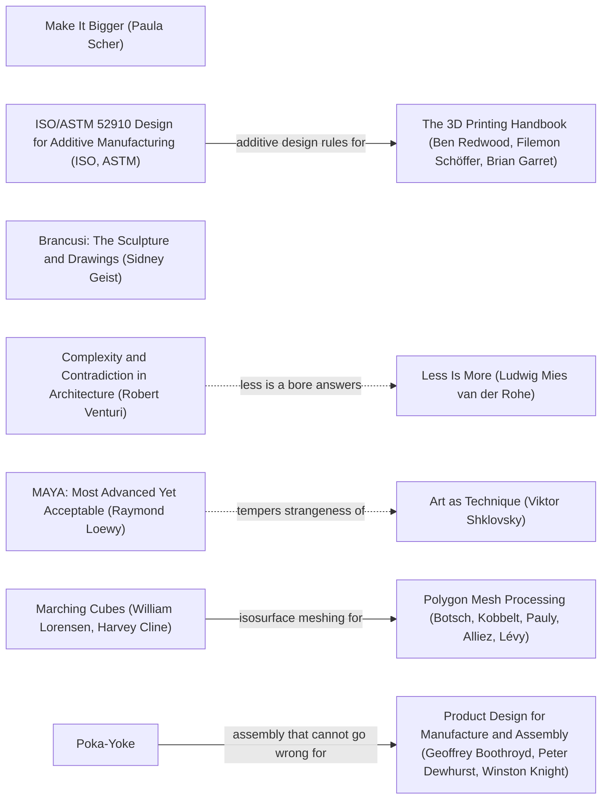

# DESIGN-LOG: lantern-drones (Lantern-pattern Squad Drone Kit, SD-1 / SD-2 / SD-C)

3DADA run, 2026-10-14, subagent build. Package: ~/projects/scifi-miniatures/lantern-drones. Inherited artifact:
concepts/armour-lantern-drones (concept.md, concept.json, source/concept.py, blockout STL).

## Step 0. Tooling inventory

| Job | Tool used | Note |
|---|---|---|
| CAD MCP context | MCP.unifiedCad.unified_get_context (called) | project_root /home/openclaw/projects; backends: cad initialized, kicad/pcb initialized (native KiCad missing), freecad DISABLED, drone + miniature builtin (heuristic); live-server miniature STL reads disabled (no airframe section), airframe disabled |
| Scope | MCP.unifiedCad.cad_get_scope (called) | READ_ONLY_ASSET_CATALOG_WITH_OPT_IN_CAD_REVISIONS; STL units unknown; self_intersection_test false |
| Inventory / provenance | cad_inspect_asset, cad_inspect_stl_geometry (live MCP, asset root /home/openclaw/projects) | R0 baseline below; final rows in the measurement table |
| Author geometry | none in the CAD MCP fits (freecad_* disabled, FreeCAD not installed in WSL). Authored outside the CAD MCP as a parametric SDF script: source/lantern.py + source/build.py on tools/sdfkit.py | "authored outside the CAD MCP" |
| Measure geometry | cad_inspect_stl_geometry (live MCP, units="mm") on every delivered STL; miniature_* tools in-process through tools/mcpcheck.py (the same unified-CAD-MCP server code, configured with read roots) | |
| Printability, scale, joints | miniature_scale_convert, miniature_detail_advice, miniature_base_and_peg, miniature_base_layout_check, miniature_slender_feature_check, miniature_gap_check, miniature_shell_audit, miniature_mesh_budget, miniature_support_plan, miniature_printability_check, miniature_plate_pack (source/check.py) | heuristic screens |
| Clearance / wall | manifold3d boolean overlap + SDF sampling (build.py fits) and miniature_gap_check / printability ray-cast walls | cad_measure_freecad_distance needs FreeCAD: UNKNOWN route |
| Render | tools/render.py (numpy + Pillow painter's renderer, key upper front-left warm, fill right cool, rim behind) | cad_preview_cad_revision needs FCStd revisions: not used |
| Exchange STEP | sdfkit.write_step needs FreeCAD: SKIPPED (not installed; brief says do not install) | STL + units sidecars only |
| Graph tooling | none available (no Mermaid renderer/graph DB in this session) | Mermaid text in this log |
| Workflow state | checklist in this log | |
| Panel | sequential, one reference at a time, written before reading the others (no per-critic sub-agents: the brief bounds this run to one package build; stated as a deviation) | |

## Step 1. Traversal Plan

**Brief, one sentence:** turn the Lantern concept blockout into a print-ready 1:56 resin kit (Wisp A/B/landed, Tick + mast +
3 weapon modules, SD-C cradle on the 2.0 mm pack peg, printed stem with clear-rod compatibility, 32 mm bases) in the
standard scifi package format, checked through the unified-CAD-MCP miniature tools.

**Mode: Adaptive.** The work serves an audience (OpenHammer players, the owner's catalogue, painters): MAYA governs. The
advanced pole is a drone tier that reads as new (chevron-plan quadcopter in a dive, a crawler with swappable modules,
worn drones); the acceptable pole is a kit that prints, assembles one way, and sits with the Vigil figures.

**3D frame.**
- Use: tabletop wargame miniatures (squad drones / tokens) at 1:56 beside 30 mm heroic Vigil infantry.
- Representation: implicit (signed-distance field) sculpt, marched to closed triangle meshes (no B-rep).
- Fate: MSLA resin print on an 8K 7-inch class printer (build volume 153.36 x 77.76 x 165 mm per tools/mcpcheck.py; brief ~165x72x180 limit also checked).
- Units and axes: millimetres at print scale, z up, parts face -y, left side on +x. STL carries no units: every print STL has a .stl.meta.json sidecar (units mm) and every MCP measurement passes units="mm".
- Formats: STL (print, per part, in print pose), viewer JSON; STEP skipped (FreeCAD absent).
- Hard limits (numbers): supported wall >= 0.4 mm and unsupported >= 0.6 mm (msla_resin preset); Wisp duct walls >= 0.8 mm (brief); Tick parts >= 0.9 mm min feature (brief); engraved detail >= 0.4 mm wide; air gaps >= 0.5 mm; wires per Formlabs table (0.3 mm/7 mm .. 1.5 mm/30 mm); suction cups <= 10 mm2; 1 body per part; triangles <= 300k per part (checker); magnet pocket floor >= 0.4 mm; socket walls >= 0.6 mm; every part within 153.36 x 77.76 x 165 mm; Wisp span 16 mm, Tick 19 x 13 x 11 mm (brief targets, +-0.5 mm).
- Requirements were not entered with cad_add_project_requirement: the cad backend's project-record tools need a configured revision/record root (scope reports writes only with configured output roots); recorded here instead.

**Seed (labels copied verbatim from references/anchor-graph.md):**
- Stance: "Make It Bigger (Paula Scher)" - heroic exaggeration of what must read at arm's length.
- Rules: "Product Design for Manufacture and Assembly (Geoffrey Boothroyd, Peter Dewhurst, Winston Knight)" -(part count and assembly for)-> ... ; "The 3D Printing Handbook (Ben Redwood, Filemon Schöffer, Brian Garret)" (walls, overhang, clearance rules); "ISO/ASTM 52910 Design for Additive Manufacturing (ISO, ASTM)" -(additive design rules for)-> The 3D Printing Handbook.
- Form (3D cluster): "Brancusi: The Sculpture and Drawings (Sidney Geist)" - reduction to the essential silhouette (chevron plan).
- Breaker: "Complexity and Contradiction in Architecture (Robert Venturi)".
- Counterpoint by a dotted edge: venturi1 -.->|less is a bore answers| "Less Is More (Ludwig Mies van der Rohe)".
- Governing: "MAYA: Most Advanced Yet Acceptable (Raymond Loewy)"; dotted edge maya -.->|tempers strangeness of| "Art as Technique (Viktor Shklovsky)".
- Mesh: "Marching Cubes (William Lorensen, Harvey Cline)" -(isosurface meshing for)-> "Polygon Mesh Processing (Botsch, Kobbelt, Pauly, Alliez, Lévy)".
- Assembly: "Poka-Yoke" -(assembly that cannot go wrong for)-> DFMA (D-flat keys).

Chain: Make It Bigger (Paula Scher) --exaggerate--> The 3D Printing Handbook --(wall, overhang and clearance rules for)--> 3MF/STL exchange;
ISO/ASTM 52910 --(additive design rules for)--> The 3D Printing Handbook; Poka-Yoke --(assembly that cannot go wrong for)--> DFMA;
Brancusi (Geist) --(reduction precedes)--> Specific Objects (Judd); Venturi1 -.(less is a bore answers).-> Mies; MAYA -.(tempers strangeness of).-> Shklovsky;
Marching Cubes --(isosurface meshing for)--> Botsch.

**Panel (Adaptive composition + 3D + fabrication seats):** Critic: Provocateur (Debord), Critic: Provocateur (Shklovsky),
Critic: Inclusion (Holmes), Critic: Inclusion (Mace), Critic: Usability (Krug) [dotted pair: crit_prov_shklovsky -.->|attacks smoothness favored by| crit_use_krug],
Critic: Human Scale (Dreyfuss), Critic: Data Gap (Criado Perez), Critic: Essential Form (Brancusi), Critic: Manufacturability (Boothroyd),
Critic: Manufacturability (Dewhurst), Critic: Mesh Quality (Botsch). 11 seats.

**First moves:** M1 Wisp print sculpt (KEEP-THE-RULE), M2 Tick hull + modules (KEEP-THE-RULE), M3 SD-C cradle + pack saddle
(KEEP-THE-RULE), M4 raked flight stem / forward-flight attitude (BREAK), M5 bases (KEEP-THE-RULE). R0 objections lead the Frontier.

### Live graph (Mermaid; no renderer available)

### R0 premortem: WHOLE panel on the inherited blockout (before any move)

Baseline measurement (live MCP):

| File (asset-root relative) | sha256 | Tool and arguments | Units (source) | Bounding box extent | Volume | Area | Shells / cavities | Boundary / non-manifold edges | Closed and oriented | Clearance or wall | Limit | Delta |
|---|---|---|---|---|---|---|---|---|---|---|---|---|
| scifi-miniatures/concepts/armour-lantern-drones/blockout/armour-lantern-drones-blockout.stl | e6956196...7208dea | cad_inspect_asset; cad_inspect_stl_geometry units=mm | mm (argument) | 94.80 x 32.00 x 29.45 | 5742.54 mm3 | 5043.56 mm2 | 5 outer / 0 | 0 / 0 | true | not measured | n/a (blockout) | baseline |

cad_inspect_asset reports **integrity INVALID ("Non-finite vertex record")** for the blockout STL although the geometry
parser still closes 5 shells. The Wisp shell (index 2) measures 16.2 x 14.6 x 5.15 mm; the cradle shell 5.6 x 4.45 x 6.9 mm.

### Panel, WHOLE, round R0  (artifact examined: concepts/armour-lantern-drones/images/armour-lantern-drones-hero.png, -turnaround.png, blockout STL row above)
| Critic | Anchor used | Observed in the work | Verdict | Requested change |
|---|---|---|---|---|
| Provocateur (Debord) | The Society of the Spectacle (Guy Debord) | the drones are generic hulls + discs; the "spectacle" is the trooper, drones are props | OBJECT | give the drone tier an image of its own (a pose, not a parked hull) |
| Provocateur (Shklovsky) | Art as Technique (Viktor Shklovsky) | Wisp hovers dead level on a vertical stem: the most habitual stand pose there is | OBJECT | make the flight strange: an attitude a stand normally forbids |
| Inclusion (Holmes) | Mismatch (Kat Holmes) | 1.6 mm clear rod is a bought part; a player without it cannot field the Wisp | OBJECT | in-kit printed stem, rod optional |
| Inclusion (Mace) | The Principles of Universal Design (Ronald Mace et al.) | Tick weapon swap shown as glued blocks; no keyed joints | OBJECT | keyed sockets that go together one way (tolerant of error) |
| Usability (Krug) | Don't Make Me Think (Steve Krug) | the cradle "plugs into the pack" but the pack has no socket behind it: which way does it go? | OBJECT | an obvious mount: one peg, one socket |
| Human Scale (Dreyfuss) | Designing for People (Henry Dreyfuss) | Wisp 16 mm span next to a 32.5 mm figure: about half a trooper, reads | PASS | keep span 16 mm |
| Data Gap (Criado Perez) | Invisible Women (Caroline Criado Perez) | the cradle is sized to one "standard" pack; other packs (jump, comms) are not measured | OBJECT | state which pack it fits and measure it |
| Essential Form (Brancusi) | Brancusi (Geist) | the Wisp hull is a convex blob; the chevron the concept names is not in the plan view | OBJECT | true chevron in plan, notch at the tail |
| Manufacturability (Boothroyd) | DFMA | blockout STL is flagged INVALID by cad_inspect_asset and overlaps parts; not printable | OBJECT | rebuild every part as one closed body |
| Manufacturability (Dewhurst) | DFMA | blockout has no tolerances, ducts are solid discs (no rotor wells), no stem socket | OBJECT | walls, wells, sockets with fit clearances from miniature_base_and_peg |
| Mesh Quality (Botsch) | Polygon Mesh Processing | convex hulls of primitives, 3096 triangles; adequate for proportion, not print | OBJECT | marched SDF mesh, no QEM decimation, shells audited |

Statements of meaning: a kit that makes squad drones part of the trooper's equipment. Artist questions: does the drone
tier read as its own scale? Critic questions: what attaches to what? Opinions: given above. Andon pulled: no.

## Frontier
| Candidate | Reached via (edge label, direction) | From anchor | Status |
|---|---|---|---|
| R0-Boothroyd/Dewhurst/Botsch: rebuild as closed, toleranced SDF parts | isosurface meshing for (out) | Marching Cubes | TAKEN (M1, M2, M3, M5) |
| R0-Brancusi: true chevron plan | reduction precedes (out) | Brancusi (Geist) | TAKEN (M1) |
| R0-Mace/Krug: keyed one-way sockets; obvious cradle mount | assembly that cannot go wrong for (out) | Poka-Yoke | TAKEN (M2, M3) |
| R0-Holmes: printed stem, rod optional | access as ambition multiplier for (in) | MAYA | TAKEN (M4) |
| R0-Shklovsky/Debord: strange flight attitude | less is a bore answers (dotted) | Venturi1 | TAKEN (M4, BREAK) |
| R0-Criado Perez: name and measure the pack the cradle fits | anthropometry / data gap | Designing for People | TAKEN (M3) |
| Mies counterpoint: does each added detail earn its place? | less is a bore answers (dotted, reverse) | Less Is More | OPEN |
| Exchange: STEP export | tessellation carried by (out) | Botsch -> STL | DEFERRED (FreeCAD not installed; brief forbids installing) |

## Decision Records

## Move M1: Wisp print sculpt, true chevron plan  (KEEP-THE-RULE)
Depends on: none
Anchors: Stance Make It Bigger (Paula Scher) | Rule The 3D Printing Handbook (Ben Redwood, Filemon Schöffer, Brian Garret) | Form Brancusi: The Sculpture and Drawings (Sidney Geist) | Mesh Marching Cubes (William Lorensen, Harvey Cline)
Intent: the Wisp reads from above as a chevron arrow between four rings; from the front as a split-chevron "face" (chin ball) under a keel.
Formal argument: claim - two swept wing bars meeting at the nose (tail notch open) carry the line's chevron better than the concept's convex hull; grounds - R0 Brancusi objection, the concept names a chevron plan that its hull lost; warrant - Geist's Brancusi reduces to one readable silhouette, and Scher's exaggeration lets the 0.9 mm keel and 0.44 mm lens bars survive at 1:56.
Alternatives rejected: (a) keep the convex hull (no chevron, R0 Brancusi stands); (b) a flat chevron plate (knife edges at the notch, <0.6 mm walls).
Consequence: more surface (triangles) than a hull; the tail notch creates a re-entrant corner that must keep >= 0.5 mm gaps.
Fence: true-scale duct walls (~0.1 mm) are broken on purpose; the rule exists because thin resin walls fail - so walls go to 0.85 mm.
Frontier effect: opens "lens legibility" and "duct wall at the well" checks; opens variants B and landed.
Mode field: Advanced pole - chevron-plan ducted quad with a split-chevron face (MAYA; Scher). Acceptable pole - same 16 mm span and duct layout as the approved concept (Dreyfuss PASS in R0).
Geometry: SDF; body = ellipsoid core + two rounded bars 2.3 x 1.5 mm nose (0,-4.7) to tails (+-3.0, 2.9); ducts r 3.0 / bore 2.15 / h 1.8 at (+-5.0, +-4.2); top well floor 0.75 mm down, blades 0.4 mm below rim, 0.6 mm rotor floor; arms 1.2 x 0.9; chin ball r 1.15 with two 0.44 mm lens bars at +-28 deg; stem boss r 1.6 with a 1.8 mm x 2.2 mm socket.
Measures: span 16.0 +-0.5 (cad_inspect_stl_geometry bbox), closed/1 shell (cad_inspect_stl_geometry, miniature_shell_audit), min wall and cups (miniature_printability_check), duct wall >= 0.8 and arm >= 0.9 (miniature_slender_feature_check across a duct wall and an arm), gaps >= 0.5 (miniature_gap_check).

## Move M2: Tick hull, mast and three keyed weapon modules  (KEEP-THE-RULE)
Depends on: none
Anchors: Rule Product Design for Manufacture and Assembly (Geoffrey Boothroyd, Peter Dewhurst, Winston Knight) | Rule ISO/ASTM 52910 Design for Additive Manufacturing (ISO, ASTM) | Poka-Yoke | Form Brancusi (Geist)
Intent: a crawler whose chevron prow and keel ridge say "Vigil" and whose deck takes any of three modules on one keyed socket.
Formal argument: claim - one deck socket (1.6 mm D-flat) for all modules + a separate mast socket (1.2 mm D-flat) minimises part variety while letting the owner swap roles; grounds - R0 Mace / Dewhurst objections (glued blocks, no tolerances); warrant - DFMA reduces distinct interfaces, Poka-Yoke makes them one-way, 52910 sizes them to the process.
Alternatives rejected: (a) weapons moulded on the hull (three hulls; no swap); (b) magnets in modules (2 mm magnets do not fit a 1.5 mm turret ring).
Consequence: module B (plough) must reach the prow from the deck: long arms that must clear the glacis.
Fence: the 0.9 mm brief floor exists because thinner resin bits snap in handling; the Talon (VW-05) red-dot is 0.84 mm, so the shared shape is grown 0.05 mm rather than redrawn.
Frontier effect: opens plough-arm clearance, track groove slivers, socket wall checks.
Mode field: Advanced pole - V mine-plough ahead of a chevron prow (chevron on chevron). Acceptable pole - VW-05 Talon reused from the line armory, so the carbine matches the troopers'.
Geometry: hull rbox 7.4 x 17.8 x 5 clipped by two chevron planes (apex y -9.5, shoulder y -6.5) and two glacis planes; tracks r 2.2, w 2.8 at x +-4.7 with 0.4 x 0.3 grooves on a 0.95 pitch; skirts 1.0 thick; deck z 6.0; sockets from miniature_base_and_peg (glue 0.1/side, depth 2.2).
Measures: hull extent ~19 x 13 (bbox), height with mast ~11 (build.json fits), min feature >= 0.9 (miniature_slender_feature_check on mast shaft, plough arm, antenna), printability per part, base_and_peg rows for both pegs.

## Move M3: SD-C cradle on the 2.0 mm D-flat pack peg + contoured pack saddle  (KEEP-THE-RULE)
Depends on: M1 (folded Wisp reuses the Wisp core and ducts)
Anchors: Poka-Yoke | DFMA | Rule Designing for People (Henry Dreyfuss) | Data gap: Invisible Women (Caroline Criado Perez)
Intent: the drone is worn like kit: a stowed Wisp behind the pack, mounted by the same peg every Vigil pack uses.
Formal argument: claim - a saddle shaped from the actual line power pack (exosuit.backpack('power')) gives the "clip on behind the pack" default a real seat and a standard 2.0 mm socket, while the cradle's own peg also plugs straight into a figure (replace-the-pack option for free); grounds - R0 Krug ("which way does it go?") and Criado Perez (which pack?); warrant - Poka-Yoke one-way D-flat, DFMA one interface reused, the data-gap critic demands the fitted pack be named and measured.
Alternatives rejected: (a) cradle replaces the pack top (owner default says clip on behind); (b) friction clip around the pack sides (0.6 mm resin clips crack; unmeasurable seat).
Consequence: stick-out behind the pack mount grows (saddle 3.4 mm + cradle ~5.5 mm); the saddle fits only the 'power' pack (jump/comms not measured - stated).
Fence: none broken.
Frontier effect: opens "stick-out vs figure balance", "saddle on jump/comms packs".
Mode field: Advanced pole - drones worn as equipment. Acceptable pole - standard peg, no new interface.
Geometry: saddle = shell + cap + socket boss minus the pack's column heightmap grown 0.1 mm (it slides down onto the pack); cradle plate 5.8 x 1.1 x 7.2, folded Wisp with ducts in a 2 x 2 stack (covers on), two straps, D-flat peg 2.0 x 2.8.
Measures: saddle/pack overlap volume = 0 and min clearance ~0.1 mm (build.json fits: manifold3d intersection + pack SDF at saddle vertices), socket wall (base_and_peg host 3.6 mm), envelope of cradle (bbox).

## Move M4: Raked flight stem - the Wisp flies nose-down  (BREAK)
Depends on: M1, M5
Anchors: Breaker Complexity and Contradiction in Architecture (Robert Venturi) | Counterpoint Less Is More (Ludwig Mies van der Rohe) (dotted edge from Venturi1, "less is a bore answers") | MAYA (governing) | Art as Technique (Viktor Shklovsky) (dotted from MAYA)
Intent: the habitual flight stand (vertical rod, level model) is replaced by a stem raked 18 deg forward from a pad behind the centre: the Wisp, socket perpendicular to its belly, takes the nose-down attitude of a quadcopter in forward flight and sits over the base centre.
Formal argument: claim - a raked stem makes the token show motion without any extra part; grounds - R0 Shklovsky/Debord objections (habitual hover); warrant - Venturi's "both-and": the stand is at once support and gesture; MAYA bounds it - same sockets, same rod, the clear-rod option survives; Shklovsky's making-strange applies to the stand the eye normally ignores.
Alternatives rejected: (a) vertical stem with a tilted socket in the Wisp (each Wisp locked to one attitude; rod compatibility same, but the Wisp then can't sit level on a vertical rod); (b) curved printed stem (a clear rod cannot follow it; breaks A1).
Consequence: the socket is a raked bore in a 3 mm base: needs a 1.4 mm launch pad to keep 3 mm of engagement and >= 0.4 mm floor; the Wisp's lowest duct comes closer to the base.
Fence: why vertical stems exist - the load path is straight and the model balances; at 18 deg the overturning moment of a ~0.3 g resin Wisp on a magnet-weighted base is negligible, and the bore is glued.
Frontier effect: opens S4 escalation (push the rake), "socket floor in a raked bore", "Wisp clearance to base".
Mode field: Advanced pole - a stand that performs (Venturi, Shklovsky). Acceptable pole - unchanged rod diameter and sockets; players still read "flying" at a glance (Krug).
Geometry: base pad r 2.4 h 1.4 at (0, 7); 1.8 mm bore along u = (0, -sin 18, cos 18), 3.2 mm deep from the pad ring top; stem 1.6 x 27 mm (22 visible + 2 + 3 inserted).
Measures: Wisp pitch (deg) and centre offset from base centre (build.json fits.flying_wisp); socket floor (geometry: lowest bore point z) and printability of the stem base; overlap stem/sockets = 0 (build.json interference).

## Move M5: 32 mm bases (stem and plain), magnet pocket vented  (KEEP-THE-RULE)
Depends on: none
Anchors: The 3D Printing Handbook (Redwood et al.) | ISO/ASTM 52910 | Poka-Yoke
Intent: the same 32 x 3 mm base footprint as the infantry, with a chevron deck-plate pattern; plain for the Tick and the landed Wisp.
Formal argument: claim - one base family with a stem variant; grounds - brief (32 x 3 mm, 5 x 2 magnet, stem socket); warrant - Redwood/52910 floors (pocket floor >= 0.4, vented pockets do not cup).
Alternatives rejected: (a) one base with the stem pad for everything (pad collides with the Tick footprint); (b) a 4 mm base like the figures (brief says 3 mm).
Consequence: two base files.
Fence: none broken.
Frontier effect: opens base_layout_check of pad, bore and pocket.
Mode field: Advanced pole - chevron deck pattern; Acceptable pole - standard 32 mm footprint and 5 x 2 magnet.
Geometry: bevel 0.8 mm; seams 0.45 x 0.35 at +-35 deg on a 6 mm pitch, stopped 1.5 mm inside the rim and outside r 3.6 (magnet floor); pocket 5.2 x 2.1 (floor 0.9); vent 1.0 x 0.6 to the rim.
Measures: base_and_peg magnet floor/rim; base_layout_check pad/bore/pocket walls; printability.

## Move M6: Ambition push - rake the stem further, 18 -> 24 deg, pad moved back to keep the Wisp centred  (BREAK, S4 escalation of M4)
Depends on: M4, M5
Anchors: Breaker Complexity and Contradiction in Architecture (Robert Venturi) | Counterpoint Less Is More (Ludwig Mies van der Rohe) (dotted from Venturi1) | Stance Make It Bigger (Paula Scher) | Governing MAYA (Loewy)
Intent: push the boldest move: a steeper dive, so the flying Wisp reads as attacking, not hovering; the pad moves back (y 7.0 -> 9.6) so the drone still sits over the base centre.
Formal argument: claim - at 24 deg the nose-down pitch is unmistakable at arm's length while the socket still holds 3.2 mm of rod with a >= 0.4 mm floor; grounds - S4 requires the BREAK pushed further and measured; warrant - Scher's exaggeration applied to the gesture, Venturi's both-and (support and gesture), bounded by MAYA (same rod, same sockets).
Alternatives rejected: (a) 30 deg (the pad would sit within 3 mm of the rim at a centred hover, and a 1.6 mm clear rod's lever arm doubles); (b) keep 18 deg (no push; S4 unmet).
Consequence: the Wisp comes lower at the tail; the stem base's pad moves 2.6 mm toward the rim.
Fence: the vertical stem exists for a straight load path; at 24 deg the bending moment on a glued 1.6 mm rod carrying a ~0.25 g Wisp is still trivial (measured mass via volume x 1.1 g/cm3 in reports).
Frontier effect: opens "pad-to-rim wall" and "Wisp-to-base clearance" rows.
Mode field: Advanced pole - dive attitude (Venturi, Scher). Acceptable pole - same rod and sockets; centred over the base (Krug: reads as flying, not falling).
Geometry: spec stem.lean_deg 18 -> 24; base.stem_boss.xy (0, 7.0) -> (0, 9.6).
Measures: fits.flying_wisp (pitch, centre offset, heights) in reports/build.json; base_layout_check pad/bore rows; printability of base-32-stem; bore floor = lowest bore point z.
## Build 1 (moves M1-M5 made) - what was measured

Made by source/build.py (full package) at 15:18-15:30. Two defects found and fixed during the move, before any panel:
- tick-hull first marched to **22 bodies**: the track-shoe grooves on the top run sit under the sponson, so each groove was a sealed void (0.73 mm3 inner shells, listed by a coarse split at 0.1 mm). Lever: grooves only on the bottom run and on the arcs below z 3.2. Re-marched: 1 body (build.json bodies = 1). Classified: regression, fixed.
- wisp-landed bbox z measured **4.33 mm** instead of the ~4.9 mm designed: the flat-foot cut had its sign inverted and was shaving the skid tops. Fixed; re-measured 4.90 mm. Classified: regression, fixed.

reports/panel-r1/build-r1.json (state judged in R1): every part 1 body, watertight; assembled interference list empty (manifold3d intersections between all 16 placed instances); saddle-on-pack overlap 0.0 mm3 but **min clearance -0.004 mm**; cradle stick-out 12.65 mm behind the pack front; flying Wisp pitch 18.0 deg nose-down, centre 0.25 mm off the base centre, bottom 21.81 mm above the base top; Tick + mast 11.5 mm tall.

### Panel, WHOLE (M1-M5), round R1  (artifact examined: reports/panel-r1/lantern-drones-hero.png, -wisp.png, -tick.png, -cradle.png, -turnaround.png; reports/panel-r1/build-r1.json)
Renders: tools/render.py, orthographic, key light upper front-left (warm), fill right (cool), rim behind; views 3/4 front (az -35, el 18), front, right side, top; cradle sheet 3/4 back, side, back, top.
| Critic | Anchor used | Observed in the work | Verdict | Requested change |
|---|---|---|---|---|
| Provocateur (Debord) | The Society of the Spectacle (Guy Debord) | hero: the Wisp is no longer a parked prop; it hangs in its own attitude over its own base | PASS | - |
| Provocateur (Shklovsky) | Art as Technique (Viktor Shklovsky) | hero: 18 deg reads as "tilted", a viewer can still see a level hover drawn badly | OBJECT | make the dive unmistakable (push the rake) |
| Inclusion (Holmes) | Mismatch (Kat Holmes) | stem is in the kit (flight-stem, 2 off), sockets 1.8 mm round take a bought 1.6 mm rod (spec A1) | PASS | - |
| Inclusion (Mace) | The Principles of Universal Design (Ronald Mace et al.) | tick sheet: modules and mast plug on D-flat pegs (flat faces forward), one way only; plough, Talon and relay share one socket | PASS | - |
| Usability (Krug) | Don't Make Me Think (Steve Krug) | cradle sheet: one peg, one socket, the saddle sits on the pack top: nothing to work out | PASS | - |
| Human Scale (Dreyfuss) | Designing for People (Henry Dreyfuss) | build-r1 fits: cradle stack reaches 12.65 mm behind the pack front; folded Wisp 9.4 x 10.35 mm, larger than the 4.8 x 6 mm pack it rides on | OBJECT | shorten the stack or justify it |
| Data Gap (Criado Perez) | Invisible Women (Caroline Criado Perez) | build-r1 fits: saddle min clearance -0.004 mm against the measured power pack: the "0.1 mm fit" is not there; jump/comms packs never measured | OBJECT | make the measured clearance real; say what happens on other packs |
| Essential Form (Brancusi) | Brancusi: The Sculpture and Drawings (Sidney Geist) | wisp sheet, top view: the V of two wing bars with the open tail notch reads between the four rings; Tick top view: chevron prow | PASS | - |
| Manufacturability (Boothroyd) | DFMA | 13 distinct files / 18 printed pieces; one interface per function (stem bore, deck socket, mast socket, pack peg) | PASS | - |
| Manufacturability (Dewhurst) | DFMA | printability not yet measured on the print-pose files (check.py run 1 was killed mid-run; only 2 of 13 parts in print/stl) | OBJECT (request to measure) | run the printability, support, gap and slender checks to completion |
| Mesh Quality (Botsch) | Polygon Mesh Processing | build-r1: every part ~245k triangles regardless of size (mast 13 mm3 to base 2230 mm3 all near the budget); the checker spent ~5 min per part, which is what killed run 1 under memory pressure | OBJECT | size the triangle budget per part class (no decimation) |

Statements of meaning: a squad's drone tier, worn and flown; the kit says "these troopers carry their eyes". Artist questions: does the dive read? does the cradle make the trooper too deep? Critic questions (neutral): how far behind the pack does the cradle reach? what clearance does the saddle really have? Opinions: in the table. Andon pulled: no.

Resolutions:
- Shklovsky OBJECT -> **ADAPT through M6** (the S4 push: 18 -> 24 deg, pad back to 9.6 mm). Record M6 written before the change.
- Criado Perez OBJECT -> **ADAPT M3**: premise measured true (-0.004 mm). Lever: the heightmap is read bilinearly, so the cut ramps across one grid cell at each column edge; dilation now clearance + one cell (lantern.pack_heightmap). Re-measure in build 2. Other packs: DEFERRED with reason - the cradle's own 2.0 mm D-flat peg plugs straight into any Vigil pack socket on a figure (replace-the-pack mode), so a jump/comms trooper can still carry a Wisp; a saddle per pack is a later kit.
- Dreyfuss OBJECT -> premise measured (12.65 mm, true). **OVERRULE** citing MAYA: the advanced pole of M3 is "the drone is worn as equipment and reads as a Wisp"; shrinking the folded Wisp (the only lever that saves more than the 2.6 mm saddle boss) would make it a different drone, and the standard 2.7 mm socket depth cannot shrink without leaving the line's peg standard (acceptable pole). The objection stays: owner may choose replace-the-pack mode (cradle peg straight into the figure, stack 8.35 mm).
- Dewhurst OBJECT -> **ADAPT tooling**: source/check.py rewritten as a cached, resumable runner (build/checkcache, keyed by tool + args + STL sha256); run to completion in build 2.
- Botsch OBJECT -> **ADAPT M1/M2/M3/M5 meshing**: budget 160k triangles for figures/modules (>= 3 voxels across 0.4 mm), 250k for bases (0.45 mm seams); re-marched, never decimated.
- Dependents reopened: M4 (by M6), M5 (stem base pad moves). 
