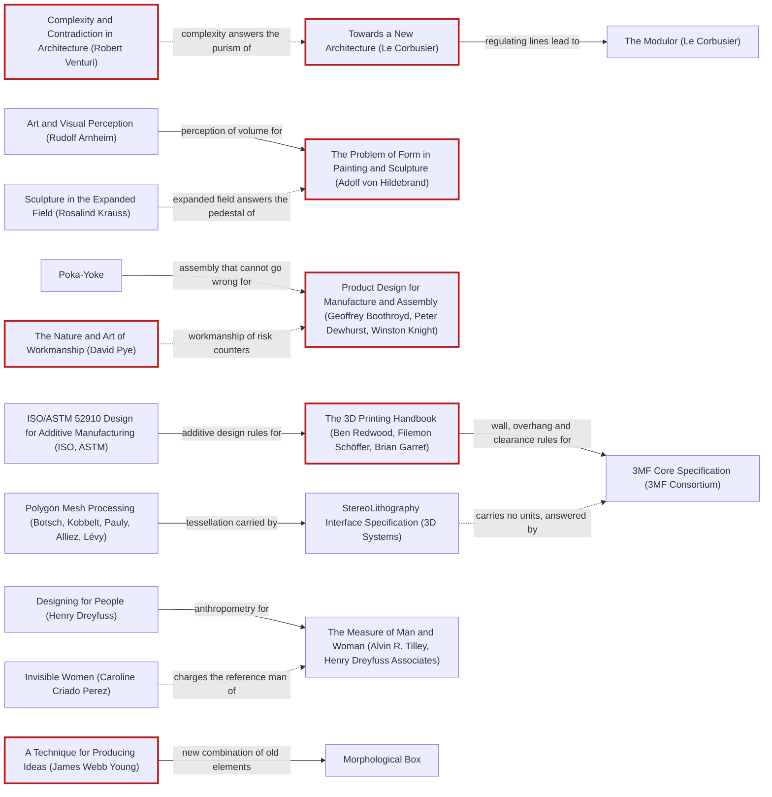

# Wayfarer-class APC (AW-8A): 3DADA design log

Package: `scifi-miniatures/wayfarer-apc/` (asset root of the Unified CAD MCP = `/home/openclaw/projects`, so every
path below is `scifi-miniatures/wayfarer-apc/...` when given to a `cad_*` tool). Run date 2026-10-14. Agent: OpenClaw
subagent "wayfarer-apc build" (anthropic/claude-opus-5-5).

No carry-forward file existed for this project (searched `scifi-miniatures` for `*carry*` / `DESIGN-LOG.md`: none), so
the run starts from `references/miniatures-lessons.md` and the concept.

## 1. Traversal Plan

### Step 0. Tooling inventory

| Job | Tool used | Notes |
|---|---|---|
| Unified CAD MCP detection | `MCP.unifiedCad` (live stdio server) | `unified_get_context`: project_root `/home/openclaw/projects`; backends kicad/cad/pcb initialized (KiCad native missing), **freecad disabled**, drone + miniature builtin, **miniature STL reads disabled on the live server** (no airframe section), airframe disabled. |
| Scope | `cad_get_scope` | READ_ONLY_ASSET_CATALOG_WITH_OPT_IN_CAD_REVISIONS; STL coordinate units unknown; self_intersection_test false; FreeCAD Python not configured, so no STEP/FCStd inspection and no `freecad_execute_python`. |
| Inventory / provenance | `cad_inspect_asset`, `cad_inspect_stl_geometry` (live MCP) | inherited blockout hashed in R0 below. |
| Author geometry | **authored outside the CAD MCP**: `source/build.py` (manifold3d CSG, exact booleans, sculpt venv). FreeCAD is not installed in WSL, so `freecad_*` is unavailable. | Shared ring standard written to `tools/turret_ring.py` (new file). |
| Measure geometry | `cad_inspect_stl_geometry` (live MCP, `units="mm"`) on every upright and print STL; `miniature_printability_check`, `miniature_support_plan`, `miniature_base_and_peg`, `miniature_scale_convert`, `miniature_floor_clearance_check`, `miniature_hollow_plan`, `miniature_split_plan`, `miniature_plate_pack`, `miniature_shell_audit` through the same server code run in-process by `tools/mcpcheck.py` (the repo's standard route, because the live server has STL reads disabled). Interference: manifold3d boolean intersection volume (LOCAL, in build.py). | Wall thickness: ray-cast method of `miniature_printability_check` (no tool reports it as a field). |
| Render for the panel | `concepts/_tools/transport_kit.raster` (numpy z-buffer, ink lines, key/fill/rim lights fixed in world) driven by build.py | `cad_preview_cad_revision` needs FreeCAD revisions: unavailable. |
| Evidence / requirements | measurement tables in this log | `cad_create_project_record` etc. need the revision root; not configured (scope) — none used. |
| Units | arithmetic in this log | STL has no units: every `cad_inspect_stl_geometry` call passes `units="mm"`; print STLs carry `.stl.meta.json` sidecars. |
| Anchor graph render / frontier | Mermaid text in this log (no graph tool in this host) | frontier computed by hand from the edge lines. |
| Workflow state | this log's Frontier table | no todo tool. |
| Panel | `agents.run` fan-out, **one agent per literary reference** | prompts carry renders + measurement rows. |
| Persist | `DESIGN-LOG.md` + git commit | |

### Brief, mode, frame

Brief in one sentence: turn the Wayfarer AW-8 concept blockout into a print-ready, detailed 1:56 resin kit (AW-8A, Tally
RWS) for the OpenHammer table, in the Vigil package format, with the hull split for a 7-inch MSLA plate.

**Mode: Adaptive.** The work serves an audience (OpenHammer players and the owner who prints and paints it) and must
read as a Vigil vehicle next to 30 mm troopers: MAYA governs. Advanced pole = the deep-V blast chevron with tumblehome
and the opening bay; acceptable pole = it reads instantly as an 8x8 APC, prints without drama, assembles one way.

| 3D frame | Value |
|---|---|
| Use | tabletop wargame vehicle model (game piece + paint subject) |
| Representation | closed triangle meshes from exact CSG (manifold3d), one solid per part |
| Fate | MSLA resin print, 8K 7-inch class |
| Units / axes | mm at 1:56; x = vehicle front, y = vehicle left, z up, ground z = 0 (same as the concept) |
| Exchange | STL per part in print pose (+ `.stl.meta.json` units sidecar); viewer JSON; STEP **skipped** (needs FreeCAD; not installed) |
| Build volume | 153.36 x 77.76 x 165 mm (repo `tools/mcpcheck.py` PRINTERS msla_resin; the brief's ~165 x 72 x 180 is looser on x/z, tighter on y; the repo value governs and is stricter on x and z) |
| Min wall | 0.4 mm supported / 0.6 mm unsupported (msla_resin preset) |
| Engraved detail | >= 0.4 mm; embossed >= 0.1 mm |
| Drain hole | >= 3.5 mm |
| Hollow shell | ~2.0 mm (brief) |
| Fit clearances | glue 0.1 / slip 0.15 mm per side (preset) |
| Mesh budget | <= 300 k triangles per checked STL (pure-Python checker limit) |
| Resin budget | 55-70 ml per complete kit (brief) |
| Scale fit | a 30 mm Vigilant must pass the ramp and hatch openings (brief) |

### Seed (labels copied verbatim from references/anchor-graph.md)

- Stance: **A Technique for Producing Ideas (James Webb Young)** — the kit is a new combination of old elements (boat hull,
  8x8 running gear, Vigil chevron/keel language, the shared ring).
- Rules: **Towards a New Architecture (Le Corbusier)** (mass under light, regulating lines of the hull stations);
  **The Problem of Form in Painting and Sculpture (Adolf von Hildebrand)** (the plate relief must read as one
  frontal plane at arm's length); **Product Design for Manufacture and Assembly (Geoffrey Boothroyd, Peter Dewhurst, Winston Knight)**
  (part count, one-way assembly); **The 3D Printing Handbook (Ben Redwood, Filemon Schöffer, Brian Garret)** (walls,
  drains, orientation).
- Breaker: **Complexity and Contradiction in Architecture (Robert Venturi)** — "both-and": an armoured closed box that is
  also an open, legible interior.
- Counterpoint (dotted): **The Nature and Art of Workmanship (David Pye)**, reached by `pye -.->|workmanship of risk counters| dfma`.
- Second dotted edge in play: `kraussField -.->|expanded field answers the pedestal of| hildebrand`.

Chains (edge labels between labels):
- Art and Visual Perception (Rudolf Arnheim) -->|perception of volume for| The Problem of Form in Painting and Sculpture (Adolf von Hildebrand) -->|problem of form for| The Art of Sculpture (Herbert Read)
- Towards a New Architecture (Le Corbusier) -->|regulating lines lead to| The Modulor (Le Corbusier) -->|human-scaled proportion for| Architects' Data (Ernst Neufert)
- Complexity and Contradiction in Architecture (Robert Venturi) -.->|complexity answers the purism of| Towards a New Architecture (Le Corbusier)
- Poka-Yoke -->|assembly that cannot go wrong for| Product Design for Manufacture and Assembly (Geoffrey Boothroyd, Peter Dewhurst, Winston Knight) -->|part count and assembly for| Manufacturing Processes for Design Professionals (Rob Thompson)
- The Nature and Art of Workmanship (David Pye) -.->|workmanship of risk counters| Product Design for Manufacture and Assembly (Geoffrey Boothroyd, Peter Dewhurst, Winston Knight)
- ISO/ASTM 52910 Design for Additive Manufacturing (ISO, ASTM) -->|additive design rules for| The 3D Printing Handbook (Ben Redwood, Filemon Schöffer, Brian Garret) -->|wall, overhang and clearance rules for| 3MF Core Specification (3MF Consortium)
- Polygon Mesh Processing (Botsch, Kobbelt, Pauly, Alliez, Lévy) -->|tessellation carried by| StereoLithography Interface Specification (3D Systems) -.->|carries no units, answered by| 3MF Core Specification (3MF Consortium)
- Designing for People (Henry Dreyfuss) -->|anthropometry for| The Measure of Man and Woman (Alvin R. Tilley, Henry Dreyfuss Associates); Invisible Women (Caroline Criado Perez) -.->|charges the reference man of| The Measure of Man and Woman (Alvin R. Tilley, Henry Dreyfuss Associates)

### Panel (Adaptive; fabricated; mesh representation)

One agent per reference, every round: Critic: Provocateur (Debord), Critic: Provocateur (Shklovsky), Critic: Inclusion
(Holmes), Critic: Inclusion (Mace), Critic: Human Scale (Dreyfuss), Critic: Data Gap (Criado Perez), Critic: Relief and
Volume (Hildebrand) [Form seat], Critic: Essential Form (Brancusi) [Form seat], Critic: Manufacturability (Boothroyd),
Critic: Manufacturability (Dewhurst), Critic: Mesh Quality (Botsch). Dotted pairs seated: Essential Form (Brancusi)
<-> Manufacturability (Boothroyd) / (Dewhurst); Data Gap (Criado Perez) -> Human Scale (Dreyfuss); Relief and Volume
(Hildebrand) -> Expanded Field (not seated; its lens kraussField is on the frontier).

### First moves

M1 KEEP-THE-RULE (one manifold, hollow, split hull), then M2 KEEP (relief layer), M3 KEEP (running gear), M4 KEEP
(shared ring + Tally RWS), M5 BREAK (open the box: ramp, hatches, visible bay, seam as panel line), M6 KEEP (print
poses). The order is a starting point; the Frontier decides after each round.



## 3. Panel Reports

### Panel R0, WHOLE (premortem on the inherited blockout; artifact examined: `concepts/wayfarer-apc/blockout/wayfarer-apc-blockout.stl` + `concepts/wayfarer-apc/images/wayfarer-apc-{hero,3view}.png`)

Eleven agents, one per reference, run in parallel with no access to each other's verdicts (agents.run). Several said
they did not open the renders and judged from the measurement rows only; their observations cite those rows, which
the evidence rule allows.

| Critic | Anchor used | Observed in the work | Verdict | Requested change |
|---|---|---|---|---|
| Provocateur (Debord) | Debord, The Society of the Spectacle §1 and §4: the spectacle is a social relation between people that images mediate. Venturi, Scott Brown and Izenour, Learning from Las Vegas: the 'duck' versus the 'decorated shed'. | I did not open the renders. The data says: 327 edge-connected shells that were never unioned; a summed volume of 216.2 ml, against a 55-70 ml target; cad_inspect_asset returns INVALID ('non-finite vertex record') while the STL reader returns STRUCTURE_VALID. So the model looks like a solid but measures as a pile of separate shells. | OBJECT | Boolean-union the hull into one closed shell and re-measure volume once the 2 mm hollow is applied. Fix the non-finite vertex. Then give the troops a readable sign: a ramp-edge or bench silhouette at 1:56, or a faction glyph on one plate, instead of a seventh plate that only says 'armour'. |
| Provocateur (Shklovsky) | Viktor Shklovsky, 'Art as Technique' (1917): ostranenie. Art exists 'to make the stone stony'; it makes perception difficult and slow instead of automatic recognition. | In the 3-view side, six identical applique plates sit at an even pitch, and the wheels form two even 4+4 pairs under a flat roofline. The keel crest is drawn as a thin yellow line, not as form. Hero view: the tumblehome and the deep-V belly are hidden in shadow. The 151 x 58 x 52 mm bbox reads as a plain box. | OBJECT | Break the automatic rhythm. Make the keel crest a raised blade about 1.5 mm proud that runs from the glacis onto the roof spine. Vary the applique plates in a deliberate 3-2-1 stepped pitch. Make the belly chevron and tumblehome visible in the hero silhouette. After the change, measure the crest height above the hull. |
| Inclusion (Holmes) | Kat Holmes, Mismatch (2018): exclusion happens wherever person and design don't fit, so design for one excluded user and the fix extends to many. | Measured bbox is 150.60 x 58.20 x 52.41 mm, with a Vigilant shoulder section of 15.4 mm. Five figures per bench need about 77 mm, which fits. The blockout is 327 overlapping shells with no defined part joints, so nothing yet guides how parts go together without close visual alignment. | OBJECT | Give the hull split asymmetric keyed locating pins and sockets, at least 2 mm, that fit only one way, and a matching keyed tab on the RWS ring. Set a rule that no separate part is under 3 mm in its smallest dimension, and measure parts against that rule. Add a tactile seam lip, not just a printed guide. |
| Inclusion (Mace) | Mace et al., The Principles of Universal Design (1997): Principle 2, Flexibility in Use; Principle 6, Low Physical Effort; Principle 7, Size and Space for Approach and Use | I did not open the renders. Measured data: the hull is 150.60 x 58.20 x 52.41 mm. The Vigilant's shoulders are 15.4 mm wide and its plan footprint is 13.74 x 23.02 mm. There are 327 separate shells, the asset reports INVALID with a 'non-finite vertex record', and the summed volume of 216.2 ml is far over the 55-70 ml target. The part count and how parts locate are not known yet. | OBJECT | Do the boolean union into keyed sub-assemblies. Give each part a single mating direction with locating pegs that can only fit one way, and use 3 mm or larger grip tabs. Check that the turret magnet pocket can be glued with no tool. Measure the inner bench length against 5 x 15.4 mm shoulders per side. Report the part count. |
| Human Scale (Dreyfuss) | Dreyfuss, Designing for People (1955) and Tilley/HDA, The Measure of Man and Woman: start from 'Joe and Josephine' and fit the machine to the person. Seat width, hatch clearance and step height come from the body measurements, not from the hull silhouette. | I did not open the renders, so this judgment rests on the numbers. Measured hull bbox: 150.60 x 58.20 x 52.41 mm. Measured Vigilant: 15.4 mm shoulder width; 13.74 x 23.02 mm plan footprint. Five seats per bench x 15.4 mm = 77 mm of bench, inside roughly 150 mm of hull. Tumblehome reduces the bay width; please measure it. Hatch apertures and step height are not measured. | OBJECT | Model a 15.4 x 23 x 32.4 mm Vigilant proxy as a fit gauge. Place ten proxies seated in the troop bay and measure: (1) bay width minus the two seat depths, which must leave an aisle of at least 15.4 mm; (2) roof hatch apertures, which must be at least 15.4 mm wide; (3) the ramp-to-floor step against the figure's height. Report these clearances before sculpting the detail. |
| Data Gap (Criado Perez) | Caroline Criado Perez, Invisible Women (2019): the 'default male' reference body. Vehicles, seats and protective equipment get sized to a single reference user, and anyone outside that template ends up fitting badly or not at all. | The only body measured is one rifleman: 15.44 x 23.14 x 32.37 mm, with a 15.4 mm shoulder section. The hull is 150.60 x 58.20 x 52.41 mm. No interior, hatch or ramp clearance has been measured. The 327 unioned shells mean nobody can yet confirm any cabin volume. | OBJECT | Add clearance checks against at least three Vigilant variants: the rifleman, a heavy or broad-pack figure and a slight figure. Measure 10 seats per bench, the minimum width of each roof hatch (≥17 mm) and the ramp opening height (≥34 mm) with cad_* section tools, and report the results. |
| Relief and Volume (Hildebrand) | Hildebrand, The Problem of Form (1893), ch. 'Relief Conception': form should read as layered planes against one unified front plane. | 3-view SIDE: the six applique plates sit flush, all on one depth layer. The roof is one flat field roughly 120 mm long. The hero view shows no shadow step between the upper hull and the fender. The bbox is 150.60 x 58.20 x 52.41 mm, with no stepped relief to measure. | OBJECT | Build three relief layers on the side: hull wall, then fender lip about 1.5 mm proud, then plates standing 0.8–1.2 mm proud with chamfered edges. Step the tumblehome break into a shadow line at least 1 mm deep. Raise the rear roof by 1 mm as a separate plane. Measure the depth of each layer. |
| Essential Form (Brancusi) | Sidney Geist, Brancusi: The Sculpture and Drawings: Geist shows Brancusi's method as reduction toward one essential volume. The Maiastra-to-Bird in Space series removes everything until a single continuous form carries the meaning. | The STL has 327 edge-connected shells, which means the primitives overlap and were never unioned. The summed volume of 216.2 ml double-counts the overlaps. The bbox is 150.60 x 58.20 x 52.41 mm. Nobody has yet measured one fused hull, so the essential form does not exist yet. It is only a collection of parts. I did not open the renders, so this rests on the measurement data alone. | OBJECT | Union the hull, belly chevron, tumblehome sides and keel crest into one closed shell, then report its shell count and volume. Before adding detail, cut the six applique plates down to three larger panels, so the hull keeps its continuity. Wheels, RWS, ramp and hatches stay separate parts. |
| Manufacturability (Boothroyd) | Boothroyd, Dewhurst & Knight, DFMA: cut the part count and design for one-way, self-locating assembly. Redwood et al., 3D Printing Handbook (VAT photopolymerisation): build volume fit, hollowing with drain holes, cupping and suction forces. | The STL has 327 edge-connected shells (overlapping primitives, not unioned) and outer_shell_count is 0. Summed volume is 216.2 ml, which overlaps double-count, against a 55–70 ml target. The bbox X of 150.60 mm leaves only 2.76 mm of the printer's 153.36 mm X axis. cad_inspect_asset reports integrity INVALID ('non-finite vertex record') while the STL reader says STRUCTURE_VALID. | OBJECT | Boolean-union the hull into one solid and clear the non-finite vertex record. Split it into an upper hull, a lower belly and eight wheels (two sprues), with keyed one-way pegs. Hollow to 2 mm with two drain holes of 3 mm or more in the belly. Measure resin volume again and rotate the hull roughly 30° in plan so it fits the plate. |
| Manufacturability (Dewhurst) | Boothroyd, Dewhurst & Knight, Product Design for Manufacture and Assembly: cut the part count first (minimum-part-count criteria). Every separate part needs its own reason to exist. Thompson, Manufacturing Processes for Design Professionals, on SLA/DLP resin: hollow parts need drain holes, and each orientation needs supports. | From the measurements: 327 edge-connected shells that were never unioned, outer_shell_count 0, and asset integrity INVALID ('non-finite vertex record'). The 216.2 ml summed volume double-counts overlaps, against a 55-70 ml target. The bbox X of 150.60 mm leaves 2.76 mm against the 153.36 mm build X. The concept states no drain holes, no split plane, and no part list. | OBJECT | Boolean-union the hull into two closed shells split at the fender line, fix the non-finite vertex, then re-measure the volume. Add a part list that passes the minimum-part-count test: 8 wheels on 2 identical 4-wheel axle sprues, plus RWS, ramp and hull halves. Mould the hatches and smoke dischargers in. Add two 2 mm drain holes on the belly. Lay out the parts for the plate. |
| Mesh Quality (Botsch) | Botsch et al., Polygon Mesh Processing, Ch.1 and 2 (a manifold needs a 2-manifold, watertight, consistently oriented surface; remeshing/CSG comes before downstream processing). Shewchuk, 'What Is a Good Linear Finite Element?': a mesh needs valid elements with no slivers. | From the measurement data only; I didn't open the renders. 327 edge-connected shells, outer_shell_count 0. The summed volume is 216.2 ml, double-counted from overlaps, so the 55-70 ml estimate can't be checked yet. cad_inspect_asset reports INVALID ('non-finite vertex record') while the STL reader says STRUCTURE_VALID. Bbox 150.60 mm is within the 153.36 mm print axis but has little margin. | OBJECT (ANDON) | Before any hollowing: find and remove the non-finite vertex record. Boolean-union the shells into one watertight outer shell. Then re-inspect to confirm shell count 1 (or one per kit part), no boundary or nonmanifold edges, and a real volume. Fix sliver triangles at the joins. Then hollow 2 mm and split. |

Statements of meaning (abridged, one per critic): *Provocateur (Debord)*: The kit sells armoured protection as a commodity image. The keel crest, the blast chevron and six alternating applique plates stage 'safety' for the buyer's eye on a box that is really a decorated shed. The ten Vigilants inside are reduced to a number you never see. *Provocateur (Shklovsky)*: The work says 'this is an APC.' It is a long, even slab on eight wheels, built as one smooth sequence of the familiar real-world cues: a slanted glacis, a row of plates, roof hatches and a small turret. The eye recognises it as a BTR or Boxer type and moves on without stopping. *Inclusion (Holmes)*: A big, readable 8x8 APC that carries a full ten-figure squad. Its modular 30 mm magnetised RWS ring is shared with the Palisade IFV, so one turret fits two kits. *Inclusion (Mace)*: The kit pitches a protective transport for everyone. Ten Vigilants ride on benches, a stern ramp lets them out, and the turret is shared with the Palisade. The vehicle is about carrying people, and the kit itself should be easy to handle and build. *Human Scale (Dreyfuss)*: The design reads as a compact, protective carrier that wraps ten soldiers in a sloped, tumblehome shell. It suggests the crew is cared for and that the vehicle can go almost anywhere, amphibious and blast-resistant. The human-scale claim rests on the claimed capacity of 10 Vigilants on two inward benches. *Data Gap (Criado Perez)*: The concept presents a protective troop carrier for ten soldiers. It sells safety through its blast-chevron belly, tumblehome sides and inward benches, and it claims the cabin was designed around the people it carries. *Relief and Volume (Hildebrand)*: A long, sealed armoured box at rest. Its mass reads as one continuous slab, and the eye skims along the length with nothing to stop it. *Essential Form (Brancusi)*: The blockout reads as a low, sealed boat-hull: a deep-V belly that rises into a keel crest up the glacis. It says this vehicle protects people and crosses water. But it states that idea once in the hull and then keeps adding to it. *Manufacturability (Boothroyd)*: A heavy, amphibious troop carrier with a blast-shaped hull. The deep-V belly, tumblehome sides and keel crest suggest it was built to survive. The RWS ring is shared with the Palisade, which makes it one part of a modular family. As it stands it is a sculptor's blockout, not yet a kit. *Manufacturability (Dewhurst)*: A compact, armoured 8x8 people-carrier. Its tumblehome hull, deep-V belly and keel crest say 'survives blasts, swims', and the Tally RWS is shared with the Palisade IFV. As a kit it promises a plate-split hull and a common magnetised 30 mm ring. *Mesh Quality (Botsch)*: The blockout gets across a compact, low, amphibious 8x8 with a strong deep-V belly and tumblehome sides. Each primitive is a clean closed shell. As a mesh, though, it is still a pile of loose parts, not one solid.

Artist questions (to the panel): Does the six-plate rhythm read as rhythm or as repetition at 60 cm? Is a true-scale bay
(1.1-1.2 m clear) acceptable if the troopers only pass the door lying down?

Critic questions: *Provocateur (Debord)*: Without the applique plates and the crest, what would tell a player at arm's length that this vehicle carries ten people and comes from the Vigil faction? *Provocateur (Shklovsky)*: Which single feature do you want a player to stare at, unable to name, before they read 'Wayfarer'? *Inclusion (Holmes)*: Who is the least dexterous or lowest-vision person you expect to assemble this hull split and ring, and what does it ask of their hands? *Inclusion (Mace)*: How do you picture a player with less dexterity putting together and handling the magnetised 30 mm turret ring and the split hull at 1:56? *Human Scale (Dreyfuss)*: When you set the 10 bench seats and the hatch openings, which Vigilant dimensions did you size them against? *Data Gap (Criado Perez)*: Which body or bodies were used to size the benches, hatches and ramp: only the measured vigil-rifleman, or a range of Vigilant poses and builds? *Relief and Volume (Hildebrand)*: Which single plane should a player read first from 30 cm away: the glacis, the side wall or the roof? *Essential Form (Brancusi)*: Which single volume do you mean to carry the vehicle's identity: the deep-V belly, the tumblehome sides, or the keel crest? *Manufacturability (Boothroyd)*: How many separate printed parts do you plan, and how will each one locate on the hull: keyed pegs, or alignment by eye? *Manufacturability (Dewhurst)*: Which features become separate kit parts (wheels, RWS, ramp, hatches, smoke dischargers, trim vane), and which are cast into the hull halves? *Mesh Quality (Botsch)*: Do you plan to Boolean-union the 327 shells into one solid before hollowing and splitting, or to rebuild the hull as a fresh sculpt?

Opinions: unanimous OBJECT on the inherited blockout. Andon pulled: **yes, by Critic: Mesh Quality (Botsch)** — 327
unjoined shells and an INVALID asset record cannot be hollowed, split or checked.

#### R0 resolutions (each objection's premise tested against the artifact first)

| Objection | Premise measured? | Resolution |
|---|---|---|
| Botsch (Andon), Debord, Brancusi, Boothroyd, Dewhurst: union into one closed solid per part, fix the non-finite record | yes: 327 shells, INVALID record (R0 row) | ADAPT -> frontier F1, taken as M1 (the blockout is replaced, not repaired: rebuild by exact CSG so every part is one manifold by construction). Andon stays pulled until M1 measures 1 shell per part. |
| Holmes, Mace: one-way keyed split and parts >= 3 mm | partly: no joints exist yet | ADAPT -> F2 (D-flat sockets + asymmetric pins, part sizes reported). Their "keyed tab on the RWS ring" is OVERRULED: the RWS must turn freely and swap between hulls (concept: shared ring); a tab would stop both. |
| Hildebrand: three relief layers, shadow step at the tumblehome break | yes: blockout plates 1.4 mm on one layer (concept.py chbox y 27.9 + 0/0.5) | ADAPT -> F3 (wall / fender lip / plates 1.2-1.7 mm proud, chine rail at the tumblehome break). His "raise the rear roof 1 mm" DEFERRED to the WHOLE round (would move the hatches and ring seat plane). |
| Shklovsky: crest as a raised blade >= 1.5 mm running onto the roof spine; break the even plate pitch | yes: crest in the blockout is 1.4 mm (concept.py, 25.8 -> 39.6 hull at x1+0.4) | ADAPT the crest (F4: blade >= 1.5 mm proud, carried along the roof spine to the ring). Plate pitch: see Brancusi. |
| Brancusi: cut six plates to three | brief fixes "six alternating side applique plates" | OVERRULE (Adaptive criterion: the acceptable pole is the owner's concept language; the plates are the faction's "plates grown off the body" rhythm shared with the Palisade). Shklovsky's 3-2-1 pitch also OVERRULED for the same reason; the alternating stand-off (two depths) is kept as the break in the rhythm. Both objections stay in the log. |
| Dreyfuss, Criado Perez: fit gauges (aisle, hatches >= 15.4/17 mm, ramp >= 34 mm) against more than one body | yes: no openings modelled; only one Vigilant measured | ADAPT -> F5 (measure the rifleman and a second, broader body: the heavy gunner) against door, hatch and aisle; the ramp >= 34 mm demand is tested in M5 against the hull height (roof 38.5 mm, door sill >= 13 mm) and recorded as a true-scale limit if it cannot hold. |
| Dewhurst: mould hatches in; split at the fender line | brief: "4 roof hatches (separate)", "split the 151 mm hull at the RWS ring line" | OVERRULE by the brief (the separate hatches are the open-hatch feature; the ring-line split hides the roof seam). Recorded. |
| Boothroyd: rotate the hull 30 deg to fit X | yes: 150.6 of 153.36 mm | SUPERSEDED by the split (each half < 85 mm). |

## Frontier
| Candidate | Reached via (edge label, direction) | From anchor | Status |
|---|---|---|---|
| F1 one manifold hollow hull, split, drains (Andon) | `botsch -->|tessellation carried by| stlFmt` (out) | Polygon Mesh Processing (Botsch, Kobbelt, Pauly, Alliez, Lévy) | OPEN |
| F2 one-way keyed split pins / D-flat axle stubs | `c_poka -->|assembly that cannot go wrong for| dfma` (in) | Product Design for Manufacture and Assembly (...) | OPEN |
| F3 three relief layers + chine shadow line | `arnheim -->|perception of volume for| hildebrand` (in) | The Problem of Form in Painting and Sculpture (Adolf von Hildebrand) | OPEN |
| F4 keel crest as a blade onto the roof spine | `venturi1 -.->|complexity answers the purism of| lecorbusier` (dotted) | Towards a New Architecture (Le Corbusier) | OPEN |
| F5 fit gauges: two Vigilant bodies vs door / hatch / aisle | `criadoPerez -.->|charges the reference man of| measureMan` (dotted) | The Measure of Man and Woman (...) | OPEN |
| F6 running gear: 8 identical wheels, chunky tread | `dfma -->|part count and assembly for| thompsonR` (out) | Product Design for Manufacture and Assembly (...) | OPEN |
| F7 shared ring + Tally RWS | `young -->|new combination of old elements| c_morph` (out) | A Technique for Producing Ideas (James Webb Young) | OPEN |
| F8 BREAK: open the box (ramp, hatches, visible bay, seam as a panel line) | `venturi1 -.->|complexity answers the purism of| lecorbusier` (dotted, Breaker) | Complexity and Contradiction in Architecture (Robert Venturi) | OPEN |
| F9 print poses, cups, supports off show faces | `dfam -->|additive design rules for| redwood` (in) | The 3D Printing Handbook (...) | OPEN |
| F10 units sidecar for every STL | `stlFmt -.->|carries no units, answered by| threemfFmt` (dotted) | StereoLithography Interface Specification (3D Systems) | OPEN |
| F11 workmanship of risk: what the painter's hand must finish | `pye -.->|workmanship of risk counters| dfma` (dotted) | The Nature and Art of Workmanship (David Pye) | OPEN |
| F12 expanded field: the vehicle on the table, no base | `kraussField -.->|expanded field answers the pedestal of| hildebrand` (dotted) | Sculpture in the Expanded Field (Rosalind Krauss) | OPEN |
| F13 human-scaled proportion of the bay | `modulor -->|human-scaled proportion for| neufert` (out) | The Modulor (Le Corbusier) | OPEN |

## 2. Decision Records (written before each move) and the run journal

## Move M1: one manifold hollow hull, split at the ring line  (KEEP-THE-RULE)
Depends on: none (answers the R0 Andon)
Anchors: Stance A Technique for Producing Ideas (James Webb Young) | Rule Towards a New Architecture (Le Corbusier) | Rule The 3D Printing Handbook (Ben Redwood, Filemon Schöffer, Brian Garret) | Rule Polygon Mesh Processing (Botsch, Kobbelt, Pauly, Alliez, Lévy) | Counterpoint The Nature and Art of Workmanship (David Pye) (dotted edge from Product Design for Manufacture and Assembly (Geoffrey Boothroyd, Peter Dewhurst, Winston Knight))
Intent: replace 327 floating primitives with two exact convex station solids (deep-V lower hull, tumblehome upper hull) unioned into one mass; hollow it to 2 mm; cut it at x = -11.5 so each half fits the plate; locate the halves with two D-flat pins in internal bosses; give every cavity a 3.5 mm drain near the split face and a vent hidden under the ring.
Formal argument: claim — the hull must exist as one closed solid per printed part before any detail is meaningful. Grounds — R0 row: 327 shells, outer_shell_count 0, asset INVALID. Warrant — Botsch: downstream processing (hollow, split, check) needs a 2-manifold; Redwood: hollow resin parts need drains and a sealed cavity is a failure; Le Corbusier: the mass is read first, so the station lines (keel 6.5, chine 14.5, sponson 21.6, tumblehome 30 -> roof 38.5) are the regulating lines everything else hangs on.
Alternatives rejected: (a) boolean-union the blockout shells — keeps the blockout's unplanned overlaps and a non-finite vertex, and its sections were never designed to be offset; (b) SDF sculpt (tools/sdfkit) — a 152 mm hull at 0.1 mm pitch is >1 M triangles, over the 300 k checker limit, and at 0.5 mm pitch the 0.4 mm panel lines vanish; (c) split upper/lower at the fender line (Dewhurst R0) — the brief fixes the ring-line split and the roof seam would run the full length.
Consequence: CSG gives crisp hard-surface facets (no organic softening); the cavity of a union of two convex pieces leaves thicker wall where they meet (never thinner); two halves add one glue joint and two pins (part count +3).
Fence: the brief's "hollow upper hull" rule exists to save resin and peel force; hollowing the lower V too keeps that intent and drains through the keel.
Frontier effect: opens F2 (pins), F9 (orientation: each half on its split face), F10 (units sidecars), F11 (the seam the painter must fill).
Mode field: Advanced pole — the deep-V/tumblehome section is now exact and offsettable (Le Corbusier). Acceptable pole — prints as two plate-sized halves that only go together one way (Redwood, Poka-Yoke).
Geometry: lower stations keel z 6.5/9.0/12.5/17.5, chine y 17.5 z 14.5; upper sponson y 27.6 z 21.6, tumblehome 30 -> 38.5 (y 21.5), glacis 47 -> 73 to z 25.5; wall 2.0 by exact plane offset; split plane x = -11.5; bosses 8.2 x 6.2 and 7.0 x 6.0 mm, sockets 3.2 mm D-flat, 3.95 deep each side; ring magnet boss r 4.5 x 3 mm under the roof; drains 3.5 mm at x -60, -16, -6, 40; roof vent 3.5 mm at (-8, 0); seam groove 0.7 x 0.45 mm.
Measures: shells per part = 1, boundary = 0, nonmanifold = 0 (cad_inspect_stl_geometry); extent of each half < 153.36 x 77.76 x 165 in some pose; volume per half (mm3); wall >= 2.0 (construction) — confirmed later by miniature_printability_check thickness.

### M1 result (measured)

Generator: `source/build.py --stage 1` (manifold3d). Measurement: live Unified CAD MCP `cad_inspect_stl_geometry`
(`units="mm"`) on `build/upright/*.stl`.

| Part | sha256 (12) | faces | shells | outer | cavities | boundary | nonmanifold | extent mm | area mm2 | volume mm3 |
|---|---|---|---|---|---|---|---|---|---|---|
| (before) blockout, 1 file | 2254c3ce31a7 | 9310 | 327 | 0 | n/a | 0 | 0 | 150.60 x 58.20 x 52.41 | n/a | 216 169 (summed, overlapping) |
| hull-front.stl | 1e54abc6316d | 1186 | 1 | 1 | 0 | 0 | 0 | 84.5 x 55.2 x 32 | 25176.5 | 24890.1 |
| hull-rear.stl | 3e449c1921ad | 800 | 1 | 1 | 0 | 0 | 0 | 61.5 x 55.2 x 32 | 20661 | 20338 |
| split-pin.stl | a1005a38b5a5 | 222 | 1 | 1 | 0 | 0 | 0 | 7.5 x 3 x 2.4 | 78.5 | 45.1 |

Delta: shells 327 -> 1 per part; R0 Andon (Botsch) **released** (closed, consistently oriented, one outer shell, no
internal cavity: the cavity opens at the split face, the drains and the vent). Kit so far 45.3 ml (2 halves + 2 pins).
Rendered: `build/panel/stage1-hero.png`, `build/panel/stage1-turnaround.png` (stage renders are kept in build/ and not
committed; the final sheets are in images/).

### Panel R1, Move M1 (artifact: `build/upright/hull-*.stl` stage 1 + stage-1 renders)

| Critic | Anchor used | Observed in the work | Verdict | Requested change |
|---|---|---|---|---|
| Provocateur (Debord) | Venturi, Scott Brown & Izenour, Learning from Las Vegas: the 'duck' vs the 'decorated shed'; Debord, Society of the Spectacle §1 (the image takes the place of lived experience) | I didn't open the renders, so this rests on the measurements only. Front half 24,890 mm³ and rear half 20,338 mm³, both manifold with boundary 0. Kit so far is 45.3 ml against a 55–70 ml budget. Split at x = -11.5, with the seam inside the turntable radius of 15.2. The move is sound: the seam hides under the spectacle of the turret rather than faking a joint. | PASS | No change needed this round. Request for later: measure what volume is left for detail (about 10–25 ml), so that greebles don't grow into a duck that hides this honest shed. |
| Provocateur (Shklovsky) | Shklovsky, 'Art as Technique' (1917): automatization swallows objects; art exists 'to make the stone stony', so the device must make the familiar strange. | I did not open the renders, so this rests on measurements only. hull-front is 84.5x55.2x32 and hull-rear 61.5x55.2x32, each with shells 1. The split is at x=-11.5, a 0.7x0.45 groove that the RWS will cover. Glacis x47 to bow z25.5. The seam is hidden on purpose, so the part strategy adds nothing to how the shape reads. For now that is acceptable. | PASS | None in this round. For M2, measure and keep one device that interrupts the familiar shape: a stated asymmetry or exaggerated keel break, of at least 1.5 mm relief, readable at arm's length. |
| Inclusion (Holmes) | Kat Holmes, Mismatch: How Inclusion Shapes Design (2018), on solving for one and extending to many, and on fixing the mismatch rather than the person. | From the data only (renders not opened): split-pin.stl measures 7.5 x 3 x 2.4 mm at 45.1 mm3. The 3 mm D-flat pin only fits one way, but it is tiny and the same front to back, so it can go in backwards. Both hull STLs are closed, with 1 shell and 0 nonmanifold edges. The 3.5 mm keel drains help resin drain and make it easier to wash and cure the halves. | OBJECT | Make the pins easier for hands and eyes that miss small parts. Put a 0.6 x 45° lead-in chamfer on each socket. Make the pin ends different (one end tapered) and add a raised arrow so it only goes in one way. Add 0.3 mm relief to the D-flat. Then print-test how the pins seat, with the halves pushed together by hand. |
| Inclusion (Mace) | The Principles of Universal Design (Mace et al., 1997): Principle 5, Tolerance for Error, and Principle 1, Equitable Use | I did not open the renders, so this is based on the data only. split-pin.stl measures 7.5 x 3 x 2.4 mm. The socket is 3.2 mm for a 3 mm pin, about 0.1 mm clearance per side. Both halves measure 55.2 x 32 mm in section and closed=true. The D-flat should prevent rotation, but I can't confirm anything stops a pin going in reversed. | PASS | No change needed this round. In M2, please measure pin clearance on a test print, add a 0.3 mm lead-in chamfer to the sockets, and make pin orientation obvious so the part can't go in wrong (Principle 5). |
| Human Scale (Dreyfuss) | Henry Dreyfuss, Designing for People (1955), and Tilley/HDA, The Measure of Man and Woman: take every dimension from the human figure that will use the thing. | Hero render: the assembled hull is 146.0 x 55.2 x 32.0 mm, which is 8.18 x 3.09 x 1.79 m at 1:56. The proxy's shoulders reach the chine line. The hull without wheels is 1.79 m deep, about one standing adult, so seated troops have headroom. The parts are manifold: 1 shell each. | PASS | No change this round. In M2, measure ride height once the wheels are on. Then check that the roof deck, around 2.6–2.9 m scale, and the rear ramp opening fit a 30 mm heroic figure: a ramp at least 1.6 m (28.6 mm) high and 1.0 m (17.9 mm) wide. |
| Data Gap (Criado Perez) | Invisible Women (Criado Perez): the 'default male' reference body. When designs are sized to one standard user, everyone outside that standard gets excluded without anyone noticing. | I measured nothing myself. The data has hull-front at 84.5 x 55.2 x 32 mm, kit at 45.3 ml, and a 7.5 x 3 x 2.4 mm split pin. The scale check uses one proxy, named in the brief for stage1-hero.png. I can't see any human data for the 3 mm D-flat pin or for interior and crew sizing. | PASS | No change to the mass this round. For M2-M5, please measure two things. First, put a smaller-frame and a bulkier-armoured proxy next to the ramp and hatches. Second, test-fit the 3 mm pins with small and large hands, and with low dexterity. Then report the clearances so the design isn't based on one default body. |
| Relief and Volume (Hildebrand) | Hildebrand, The Problem of Form (1893): form should read as a unified relief from the distant view (Fernbild), with depth planes stacked clearly behind one front plane. | Left side view in the turnaround: three horizontal bands of nearly equal height (keel V, sponson, casemate) with no main plane. The seam at x -11.5 cuts all three bands top to bottom. Both halves measure shells 1 and closed true. The split is buildable. | PASS | Nothing for M1. For M2, give one band visual priority so the side reads in planes: the wheels and sponson should outweigh the keel V, which they will mostly hide. Measure how much of the keel is visible above the wheel line at eye height. |
| Essential Form (Brancusi) | Sidney Geist, Brancusi: The Sculpture and Drawings — the reduction to one continuous, self-sufficient mass (Bird in Space, Fish), where seams and parts serve the whole form. | Turnaround, left side: the chine, sponson and tumblehome form three parallel horizontals of almost equal weight, so the side has no dominant line. Measured: both halves have 1 shell, 0 nonmanifold edges and are closed. Front extent is 84.5 mm and rear 61.5 mm; the halves total 45.3 ml, within the 55–70 ml kit budget. | PASS | No change needed this round. Recommendation for M2: make the sponson line (z 21.6) the dominant edge, and keep the chine and roof facets secondary so the hull reads as one continuous wedge. |
| Manufacturability (Boothroyd) | Boothroyd, Dewhurst & Knight, Product Design for Manufacture and Assembly, ch. 3: the minimum-part-count test, which asks whether a part moves, needs a different material, or must come apart for service. | Both halves are clean: 1 shell each, 0 cavities, 0 non-manifold edges, closed. The front half (84.5 x 55.2 x 32) fits the plate. The kit totals 45.3 ml against a 55-70 ml budget. The split pin (7.5 x 3 x 2.4 mm, 45.1 mm3) is a third loose part type, which you would expect to get lost. | OBJECT | Remove split-pin.stl. Print two 3.0 mm D-flat pegs, 3.5 mm long, directly onto the hull-rear seam face, fitting the existing 3.2 mm front sockets. Add a 0.3 mm chamfer at each peg tip. That brings the hull to 2 parts, then re-measure. |
| Manufacturability (Dewhurst) | Boothroyd, Dewhurst & Knight, Product Design for Manufacture and Assembly, ch. 3: minimum-part-count criteria. A part must justify being separate through relative motion, a different material, or disassembly. Thompson, Manufacturing Processes for Design Professionals, on vat photopolymerisation (SLA/DLP): hollow walls must have drain holes. | Both halves are valid: 1 shell, 0 nonmanifold, closed. Together they are 84.5 + 61.5 = 146 mm long, under the 153.36 mm plate. split-pin.stl is a separate 45.1 mm³ part, used twice. Volume is 24890.1 + 20338 mm³; the kit is at 45.3 of the 55-70 ml budget. I did not inspect the renders. | OBJECT | Remove split-pin.stl. Model the two 3 mm D-flat pegs directly onto the hull-front mating face, with 0.15 mm clearance to the rear sockets. That takes the hull assembly from 4 parts to 2 and leaves no loose pins to lose. Also report a measured one-piece 146 mm fit test on the plate, so the split is justified. |
| Mesh Quality (Botsch) | Botsch et al., Polygon Mesh Processing, Ch.1 (closed two-manifold, Euler/genus validity) and Ch.6 (remeshing quality); Shewchuk, What Is a Good Linear Finite Element? (sliver triangles and aspect ratio) | hull-front: 1186 faces, 1 shell, 0 boundary edges, 0 nonmanifold, closed. hull-rear: 800 faces, same validity. Pin: 222 faces, closed. Rough wall check: half the area times 2 mm gives about 25.2 ml for the front (measured 24.9 ml) and about 20.7 ml for the rear (measured 20.3 ml), so both halves are a consistent 2 mm hollow. R0 had 0 outer shells; now each part has 1. | PASS | No change needed this round. Before M2 adds detail, report the minimum angle and the maximum aspect ratio for each half. Remesh or clean up slivers only where later booleans will cut, so their seams stay well-conditioned. |

Statements of meaning: *Provocateur (Debord)*: The hull is now an honest decorated shed. It's one closed, hollow 2 mm box (shells 1, closed true for each half) with no ornament yet. The 327-shell spectacle of the blockout is gone, and the mass has to carry the meaning before any added sign can claim it. *Provocateur (Shklovsky)*: From the numbers alone, the move says: this is a real, honest object. It is one closed shell per half, with an exact 2.0 mm wall, a deep-V keel and tumblehome. It is a correct mass that ships as a kit. It does not yet say that this vehicle is strange or belongs to Vigil. *Inclusion (Holmes)*: One closed hull that splits at the ring line says the vehicle is a single object, and the seam is hidden under the turntable. Holes, pins and the magnet are planned in before detail goes on. That makes it a kit people can trust to go together. *Inclusion (Mace)*: The move turns an invalid 327-shell blockout into a clear two-part hull. Both halves are closed, single-shell and manifold. The split hides under the turret, and pins locate the halves. A novice builder should be able to put this together. *Human Scale (Dreyfuss)*: It is a single armoured shell sized to carry people, cut where the turret ring will cover the cut. It reads as a closed troop compartment rather than a heap of loose shapes. *Data Gap (Criado Perez)*: A clean, closed and honest mass. Two manifold halves (shells 1, boundary 0, nonmanifold 0) replace the 327-shell blockout that didn't count as a valid asset. The vehicle says it can be printed and built. Its scale is judged against a single Vigilant proxy on a 32 mm base. *Relief and Volume (Hildebrand)*: The hull is one closed volume, 146 x 55.2 x 32 mm. A deep-V keel sits under a tumblehome casemate, giving a low, sealed, amphibious mass. Reducing 327 loose shells to one shell per half makes the hull read as a single body at last. *Essential Form (Brancusi)*: A single sealed, armoured volume: a deep-V belly carrying a faceted, inward-sloping upper hull, read as one wedge. It suggests protection by mass alone, before any detail is added. *Manufacturability (Boothroyd)*: The hull is now one honest, watertight shell split at a natural seam. The turntable is meant to hide the roof seam. The mass reads as a single cast body, not 327 loose fragments. *Manufacturability (Dewhurst)*: One sealed, hollow resin body that reads as a single armoured mass. It is cut at the ring line so the cut hides under the turntable, and it is located by keyed pins, so anyone can assemble a clean hull. *Mesh Quality (Botsch)*: The move swaps a 327-shell sketch for a real solid. Each part is now one closed, watertight surface with a uniform 2 mm wall. The mass reads as a single object with a single split, not a pile of parts.

Critic questions: *Provocateur (Debord)*: When M2–M5 add detail, which reading of the vehicle (troop carrier, fighting platform or parade float) should the bare deep-V-and-tumblehome silhouette already declare without help? *Provocateur (Shklovsky)*: Which part of the hull silhouette do you want a player to notice as unfamiliar, the first time they see the model on the table? *Inclusion (Holmes)*: Who did you picture assembling it: someone with steady fine motor control, or a hobbyist with tremor, low vision or arthritic hands? *Inclusion (Mace)*: How does a builder whose fingers are less steady seat a 7.5 x 3 x 2.4 mm D-flat pin in a 3.2 mm socket? Can the halves go together the wrong way round? *Human Scale (Dreyfuss)*: Which human measurement fixed the 32 mm hull height and the ring-line split? Did you work from the Vigilant proxy's seated and standing heights, or from the real 8x8 vehicle? *Data Gap (Criado Perez)*: Which bodies and which hands did you use to set the 38.5 mm roof, the 30 mm tumblehome and the 2.0 mm wall? Was it only the one 30 mm heroic Vigilant proxy shown in the hero render? *Relief and Volume (Hildebrand)*: From 1 m on the table, what should a player read first as the front plane: the glacis edge, the sponson line at z 21.6, or the roof? *Essential Form (Brancusi)*: Which one profile line do you want a player to read first from across the table: the chine, the sponson or the glacis break? *Manufacturability (Boothroyd)*: Why are the alignment pins separate printed parts and not pegs printed onto one hull half? *Manufacturability (Dewhurst)*: What does the x = -11.5 split buy that one hollow 146 mm hull could not? Is it the print orientation, suction cupping, or the 165 mm height of the build volume? *Mesh Quality (Botsch)*: Did the boolean union and plane-offset hollowing leave long sliver triangles along the chine, sponson and glacis lines? What is the minimum triangle angle on each half?

Andon: none. Sharpest disagreement: Boothroyd and Dewhurst (fold the pins into a half: 4 hull parts -> 2) against the
support-free pose M1 chose (each half printed standing on its flat split face; a half carrying pegs cannot stand on that
face).

#### R1 resolutions

| Objection | Premise tested against the artifact | Resolution |
|---|---|---|
| Holmes (and Mace's note): lead-in chamfers, pin cannot go in backward, relief on the D-flat | sockets had no lead-in (build.py M1 `d_cutter` plain cylinder); the pin is symmetric along its length only at the far end (tip chamfer on one end) | ADAPT: 0.45 mm x 45 deg lead-in cone on all four socket mouths; pin chamfered 0.3 mm on **both** ends so either end is the right end (the D-flat still fixes roll). Raised arrow not added: once both ends are identical there is no wrong end. Kit ships 3 pins (1 spare). |
### M2R result (measured)

| Part | sha256 (12) | faces | shells | boundary | nonmanifold | extent mm | volume mm3 | delta vs M2 |
|---|---|---|---|---|---|---|---|---|
| hull-front.stl | c6547633fe19 | 6164 | 1 | 0 | 0 | 86.1 x 59 x 35.65 | 25608.7 | -2403.8 |
### M3 result (measured)

## Move M7: ambition push of the Breaker — a continuous troop deck  (BREAK, S4 push)
Depends on: M5, M5R, M6
Anchors: Breaker Complexity and Contradiction in Architecture (Robert Venturi) (dotted `venturi1 -.->|complexity answers the purism of| lecorbusier`) | The Modulor (Le Corbusier) via `modulor -->|human-scaled proportion for| neufert` | Counterpoint The 3D Printing Handbook (Ben Redwood, Filemon Schöffer, Brian Garret) (the push must still print)
Intent: push the boldest move (opening the box) further: the bay floor runs the whole rear half (stern wall to the split) at 1.0 mm instead of a 25 mm stub, so through the four big hatches and the door the bay reads as one continuous deck between the benches — the "open" half of the contradiction becomes a place, not a hole into the V void.
Formal argument: claim — an opening is only legible if what it reveals is legible. Grounds — stage-6 deployed render: past the 25 mm stub the hatches look into the dark V void. Warrant — Venturi (both-and: the closed box must also be a real interior), Le Corbusier's Modulor (a deck at seated-human proportion: seat 10.5 mm over the deck = 0.59 m).
Alternatives rejected: full interior (crew stations, rifle racks): over the resin budget and invisible; a separate interior insert part (+1 part, Boothroyd).
Consequence: ~+0.5-0.8 ml; the rear cavity is split into deck and V void below it (both still vented at layer 0 by the split-line vents and the x -60 keel drain).
Fence: kit stays <= 70 ml; printability must still PASS; reverted if the WHOLE round rejects it.
Frontier effect: tests F12 (the deployed tableau).
Mode field: Advanced pole — the vehicle as a stage for its troopers; Acceptable pole — invisible when buttoned up.
Geometry: floor z 11.5-12.5 from x -71.2 to the split plane (-11.5), clipped to the hull solid.
Measures: kit ml, rear-half ml, printability PASS (cups, thin), interference 0, deployed render.

### R8 fix result: check run 6 FAILED (recorded as measured)

The R8 fixes were re-checked, and that check **failed**. The R8 resolution above ("Re-checked below") points here.
- Wheel: fixed. Min wall > 0.9 mm, area below 0.4 mm = 0 (the hub chevron is now one polygon).
- Hull rear: **FAIL, minimum wall (supported) = 37.02 mm2** thinner than 0.4 mm (limit 0.5 mm2). Located at model
  x -71.15 / -70.94, y +-4.3..6.9, z ~35.8-36.0 (0.12-0.26 mm). Cause: stopping the door cut at the stern wall's inner face
  (to cure the sill-corner sliver) left a wedge of the stern bevel over the door lintel. The bevel's inner face reaches only
  z 35.5 at the wall face, but the door top is at 36.2. So the fix for one sliver created a larger one.
- Response (unverified when this entry was written): a two-part door cut. Below z 30 it goes through the wall only
  (keeps the sill-corner fix); above z 30 it runs on to x -70.2, past the line (x -70.48) where the inner bevel meets the
  roof underside. Check run 7 decides; its result is recorded in the next entry, whatever it is.

So the M6 iteration count is now six check runs, not five. The "five check runs to PASS" heading above described the state
before R8, and it held only until the R8 edits reopened the rear half.

### Check run 7 (after the two-part door cut): PASS

`reports/printability.json` 16:41:44 (newer than the build): problems [], all_pass true. Per-part thin-area results (area
thinner than 0.4 mm, limit 0.5 mm2):
```
hull-front {} 0.226 0.315
hull-rear {} 0.231 0.262
wheel {} > 0.9 0
rws {} 0.447 0
ramp {} 0.566 0
hatch {} 0.66 0
split-pin {} > 0.9 0
```
M6 took seven check runs in total (1-4 before the panel, 5 PASS, 6 FAIL after the R8 edits, 7 PASS).
